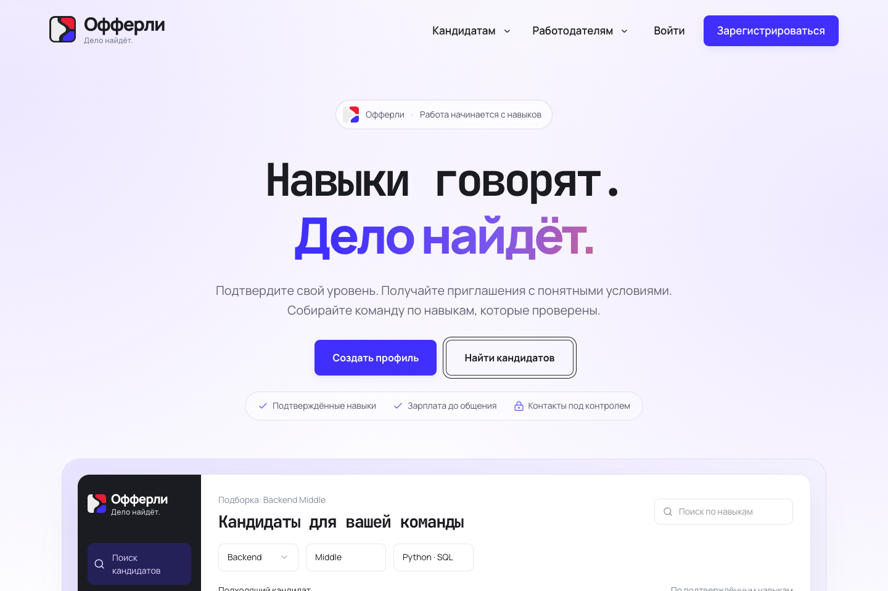
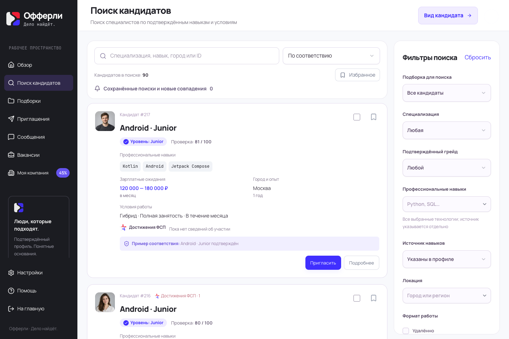
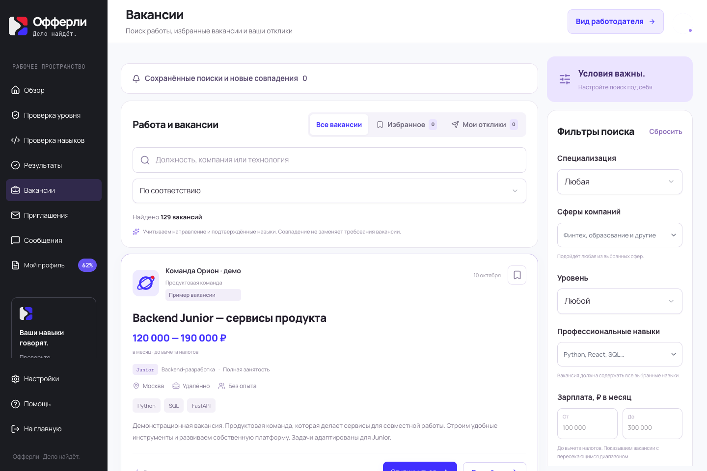
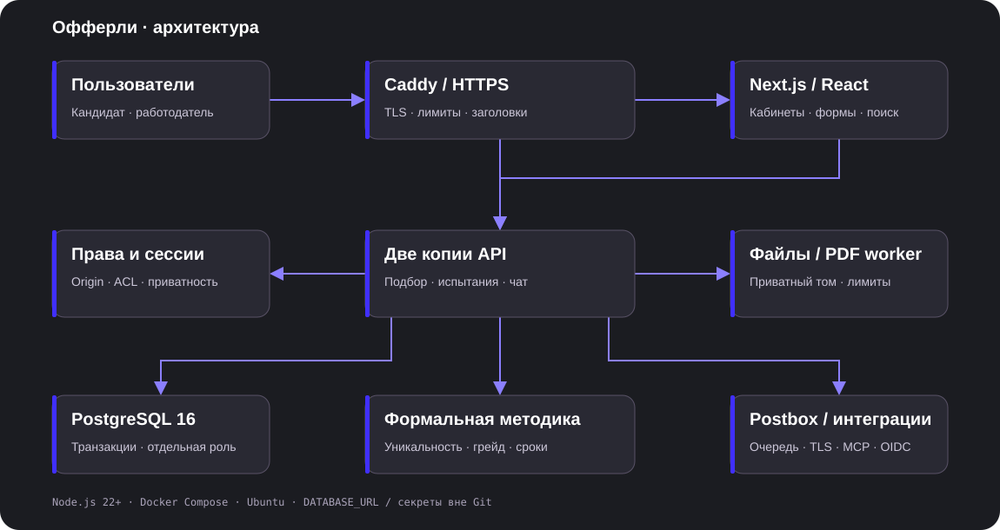
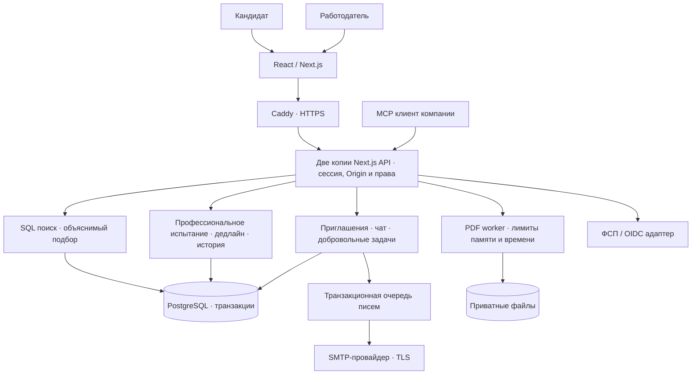

<div align="center">


# Офферли
### Дело найдёт.

**ИТ-платформа, где работодатель находит кандидата по подтверждённой категории.**

[Сайт](https://opherly.ru) · [Документация](docs/README.md) · [OpenAPI](docs/api/openapi.json) · [Методика испытаний](docs/assessment/README.md)

</div>

Офферли соединяет кандидата и компанию напрямую. Резюме описывает опыт, профессиональное испытание подтверждает специализацию и уровень, а поиск объясняет причины подбора. Работодатель отправляет приглашение с зарплатой. Контакты открываются участвующей компании после согласия кандидата или самостоятельного отклика.

## Посмотреть



| Поиск кандидатов | Вакансии |
|---|---|
|  |  |

> **Скринкаст:** место для будущего видео. [Сценарий записи](docs/video/README.md). Видео ещё не опубликовано.

На скриншотах демонстрационные данные. В реестре ФСП используется явно обозначенный локальный контур: реальные данные организатором не предоставлены.

## Что работает

- Два кабинета: кандидат и работодатель. Ручной профиль, импорт текстового PDF с распознаванием и просмотром найденной фотографии, стандартный PDF-профиль.
- 12 специализаций × Junior / Middle / Senior; уникальные параметризованные программы испытаний, история, серверный таймер, ограничения повторных попыток.
- Поиск с фильтрами, сортировкой и страницами по 20 карточек; сравнение, сохранённые условия, объяснимый подбор по задаче, публикация вакансий и отклики.
- Приглашения с зарплатой, принятие и отказ, переписка, черновики, защита от повторной отправки сообщения, уведомления.
- Добровольная задача в чате: сначала видно только предложение и длительность; условия открываются после подтверждения готовности. После срока выполнение закрывается; сохраняется последний успешно отправленный черновик.
- Подтверждение почты, оба способа смены адреса, восстановление пароля, отзыв сеансов, фирменные письма и очередь приглашений.
- MCP работодателя с ограниченными правами и отзывом токенов; адаптер ФСП / совместимость с Keycloak OIDC.

Отдельные технологические проверки пока помечены «В разработке». Регулярная автоматическая выдача задач и OCR сканов не реализованы. Испытания — формальная методика с синтетической валидацией; человеческий пилот остаётся отдельным этапом.

## Стек

| Слой | Технологии |
|---|---|
| Интерфейс | React 19, Next.js 16, TypeScript, Tailwind CSS 4, Radix / Base UI |
| Дизайн | Manrope, JetBrains Mono, фирменные цвета ФСП / Офферли |
| Сервер | Node.js 22+, Next Route Handlers, транзакции PostgreSQL |
| Данные | PostgreSQL 16; PGlite для одного локального dev-процесса |
| Испытания | Встроенный формальный генератор и оценка `vendor/fsp-assessment` |
| Файлы | Приватный том, Sharp; изолированный worker для PDF / unpdf |
| Почта | Nodemailer, сменяемый SMTP-провайдер; файл или Mailpit локально |
| Интеграции | OpenAPI, MCP, OIDC / Keycloak |
| Развёртывание | Docker Compose, Caddy, HTTPS, Ubuntu VPS |

## Архитектура





Приложение работает от отдельной роли БД без прав администратора и изменения схемы. Миграции выполняет одноразовый сервис с отдельными полномочиями. База не имеет публичного порта. Корневая файловая система контейнера приложения доступна только для чтения; записывать можно в ограниченный временный каталог и приватный том файлов.

[Техническая защита](docs/architecture/security.md) · [Данные и согласия](docs/architecture/data-policy.md) · [Нагрузка и повторы](docs/architecture/capacity-and-retakes.md) · [Интеграции](docs/architecture/integrations.md)

## Быстрый локальный запуск

Нужны **Node.js ≥22.17** и npm. На новой машине:

```sh
git clone --branch main ssh://git@gitverse.ru:2222/Yujir0k/redsite.git
cd redsite
npm ci
npm run setup:local
npm run dev
```

Открыть **http://localhost:5174**. Настройка создаёт приватный `.env.local`, не перезаписывает существующие данные. База PGlite находится в `.data/postgres`; её должен открывать только один процесс.

По умолчанию письма остаются в локальном файле и не отправляются наружу. Прочитать код собственного тестового аккаунта:

```sh
npm run mail:latest -- your-test-address@example.test
```

Для локального Mailpit: `npm run setup:local -- --mailpit` на свежей копии, затем `npm run dev:mail` и `npm run dev`. [Подробная инструкция](docs/guides/local-mail.md).

## Запуск через Docker

Нужны Docker Engine / Docker Desktop и Compose v2. Node на хосте не обязателен:

```sh
docker run --rm -v "$PWD:/workspace" -w /workspace node:22-bookworm-slim node scripts/setup-docker.mjs
docker compose --env-file .env.docker up --build -d
docker compose --env-file .env.docker ps
curl http://localhost:3000/api/health
```

Открыть **http://localhost:3000**. Эта конфигурация предназначена для локального демо: HTTP, синтетический каталог, без внешней почты. Для полного пути с почтовым подтверждением используйте нативный локальный запуск выше либо настройте собственный SMTP и HTTPS production-окружение. Коды не подменяются тестовым универсальным значением.

Образ сам собирает генератор и PDF worker. Compose запускает PostgreSQL → миграции → приложение. База и файлы сохраняются в именованных томах; `docker compose down` их сохраняет. **Не используйте `down -v`, если данные нужны.**

## VPS / production

1. Скопировать `.env.vps.example` в приватный `.env` и задать **два разных** случайных пароля БД, домен, SMTP и прочие нужные параметры.
2. Собрать образ: `docker compose build`; запустить: `docker compose up -d`.
3. Настроить DNS и Caddy по `deploy/Caddyfile.example`. Приложение слушает только `127.0.0.1:3000`, БД наружу не выставляется.
4. Проверить HTTPS, `/api/health`, реальные письма, права разных компаний и восстановление отдельной резервной копии.

Для Aeza применяется также `deploy/compose.vps.yml` с явно указанным тегом релиза: две одинаковые копии app за Caddy, общие PostgreSQL и uploads. Пример Caddy рассчитан на эти два upstream; при обычном одноузловом Docker-запуске оставьте только `127.0.0.1:3000`. Секреты, реальные аккаунты, базы, загрузки и резервные копии в репозиторий не входят.

[Почта](docs/guides/production-mail.md) · [Чеклист запуска](docs/guides/production-checklist.md)

SMTP.BZ подтвердил домен. 11.10.2026 с VPS отправлены три фирменных тестовых письма: подтверждение, восстановление пароля и приглашение; SMTP принял их, получатель подтвердил доставку. Обычные шаблоны не содержат названия провайдера; письма с кодами не содержат ссылок или вложений. Автоматическая отправка работающего сайта ещё использует Postbox: переключение требует отдельной выкладки после разрешения на замену контейнеров приложения. Секреты SMTP хранятся вне Git.

## Проверки

```sh
npm run lint
npm run check:types
npm run check:api
npm run test:security
npm run test:mail
npm run test:regression
npm run test:grade-matrix
npm run build
```

Свежие результаты подготовки к публикации: [отчёт от 11.10.2026](docs/reports/2026-10-11/publication-verification.md).

[Минимальные резервные копии MVP](docs/guides/minimal-backups.md): горячая копия только на VPS дважды в неделю, три последних архива. На Mac автоматического копирования нет. Без новых услуг, обновлений ОС и перезапусков приложения.

[Сценарии QA](qa/README.md) включают файлы, фильтры, контактные права, задачи, отключение сети, историю и повторные попытки. Операционные VPS-проверки используют собственные синтетические аккаунты и закрытый туннель; их нельзя запускать на чужих данных без настройки.

Нагрузочный прогон проверяет ограниченные ступени чтения с паузой между действиями. Число виртуальных клиентов не является обещанием максимального числа пользователей при любых действиях.

## Структура репозитория

```text
app/                 страницы, стили и API
components/          интерфейс кабинетов и форм
hooks/               состояние и сетевые запросы интерфейса
lib/                 права, доменная логика, поиск, файлы, почта
db/                 подключение и последовательные миграции
vendor/fsp-assessment/ генератор, правила оценки и исходные тесты
public/              фирменные ресурсы, шрифты, иллюстрации
scripts/             сборка, настройка, миграции, эксплуатационные команды
deploy/              конфигурация VPS и HTTPS
qa/                  unit, интеграционные и браузерные проверки
docs/                архитектура, API, инструкции, отчёты и скриншоты
output/pdf/resume-benchmark/ синтетические PDF-эталоны
```

## Границы готовности

Реальная ФСП-интеграция ждёт контракта организатора; ТЗ допускает собственные тестовые данные. Для массового публичного запуска нужны документы оператора персональных данных, политика хранения, регулярные внешние резервные копии и мониторинг. Программные защиты и согласия не являются самостоятельным заключением о нормативном соответствии или гарантией отсутствия уязвимостей.

[Текущая проверка и оставшиеся пункты](docs/reports/2026-10-11/security-final.md). [Подробная матрица ТЗ](docs/reports/2026-10-10/tz-audit-final-20261010.md). Исторические отчёты отражают дату конкретного прогона и не заменяют текущую проверку.
