## ▶️ Демонстрация

[Смотреть полное видео проекта (8:54)](offerly-demo.mp4)

## Лидеры цифровой трансформации 2026 · кейс ФСП

**Офферли** — командный проект R² negative: сервис проверки квалификации и подбора IT-специалистов. Решение разработано для кейса Федерации спортивного программирования на хакатоне «Лидеры цифровой трансформации».

---

<div align="center">


# Офферли

## [▶ Смотреть демонстрацию продукта · 8:57](https://drive.google.com/file/d/1NSkari65RXaiNPmRnXNd-gHujYh2MLH1/view)

**Рекомендуем ознакомиться с видео, чтобы лучше понять, как работает продукт.**

---

### Дело найдёт.

**Проверка квалификации и подбор IT-специалистов под задачи команды.**

[Платформа](https://opherly.ru/) · [Документация PDF](docs/readme/offerly-documentation.pdf) · [Техническая документация](docs/README.md) · [OpenAPI](docs/api/openapi.json)

**[Презентация PDF](docs/readme/offerly-presentation.pdf)**

<!-- После получения презентации замените её заглушку ссылкой. -->

[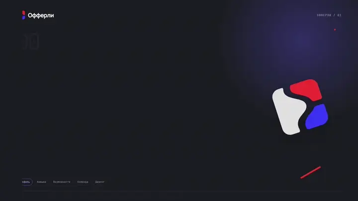](docs/readme/media/offerly-preview-60s.mp4)

[Смотреть исходный ролик · 60 секунд](docs/readme/media/offerly-preview-60s.mp4)

</div>

Кандидат заполняет профиль и проходит профессиональное испытание. Работодатель видит основания оценки, подбирает специалистов под задачу и отправляет предложение с зарплатой. Кандидат выбирает, с какой компанией продолжить общение.

**12 специализаций · 3 грейда · до 20 минут на испытание · объяснимый подбор · MCP работодателя**

На скриншотах ниже — демонстрационные данные. Экспертное прохождение показывает устройство проверки и не подтверждает настоящий грейд.

## Содержание

- [От задачи к решению: путь кандидата](#candidate)
- [Почему до 20 минут и как определяется грейд](#timing)
- [Защита от слива и заучивания](#protection)
- [Компетенции и типы заданий](#tasks)
- [Валидация и результаты](#validation)
- [Кабинет работодателя, подбор и MCP](#employer)
- [Архитектура, API и ФСП](#architecture)
- [Запуск, нагрузка и эксплуатация](#running)
- [Следующие шаги и исследования](#research)


<a name="candidate"></a>

## От задачи к решению: путь кандидата

При построении решения нам важно было разделить то, что кандидат сообщает о себе, и то, что подтверждает проверка. Поэтому путь начинается с профиля, продолжается испытанием и подбором под задачу команды, а заканчивается приглашением и общением с согласия кандидата.

Чтобы сократить заполнение профиля, добавили разбор PDF-резюме. Он работает локально, по правилам, а перед сохранением кандидат проверяет поля. Есть ручной ввод и два варианта экспорта в PDF; распознавание сканов пока не реализовано.

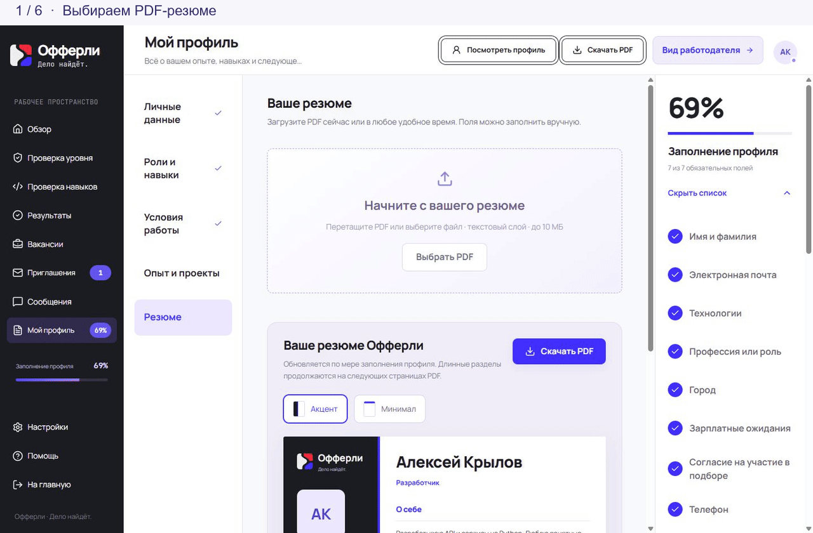

_Загрузка PDF, выбор распознанных полей и сохранение профиля на демонстрационном аккаунте._

Категория объединяет специализацию и подтверждённый грейд. Непроверенный уровень обозначается как заявленный; при заполненном профиле и согласии на видимость он тоже может быть доступен работодателю.

### Как пользоваться кабинетом кандидата

| Шаг | Что доступно |
| --- | --- |
| Создать профиль | Указать опыт, проекты, технологии, формат работы и зарплатные ожидания; импортировать текстовое PDF-резюме и проверить распознанные поля |
| Подтвердить уровень | Выбрать специализацию и Junior, Middle или Senior; пройти сценарии, инцидент и ревью |
| Посмотреть результат | Открыть отчёт по компетенциям и историю; различать заявленную квалификацию и подтверждённую |
| Найти возможность | Просматривать вакансии, сохранять их, отправлять отклики и отслеживать статусы |
| Ответить компании | Рассмотреть приглашение с зарплатой, принять или отклонить его; при согласии продолжить разговор в чате |
| Управлять профилем | Менять видимость и согласия, скачивать PDF в оформлении «Акцент» или «Минимал», управлять аккаунтом и сеансами |

Обзор собирает приглашения, отклики, подходящие вакансии и уведомления. Принятие приглашения и самостоятельный отклик — явные действия кандидата, после которых конкретная компания получает доступ к общению и контактам. Проверка работодателя в чате не меняет профессиональный грейд.


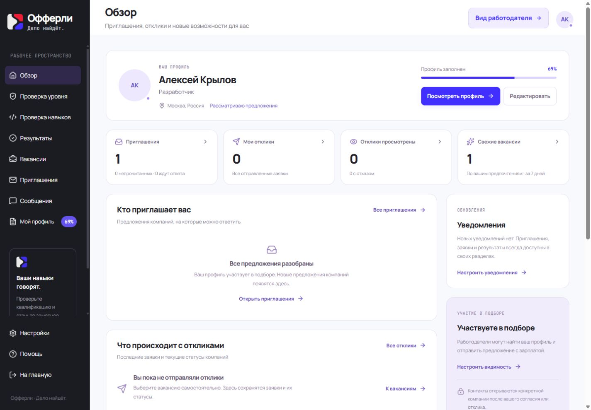

_Приглашения, отклики, вакансии и состояние профиля на одном экране._

<details>
<summary>Ещё экраны: главная, регистрация и профиль кандидата</summary>

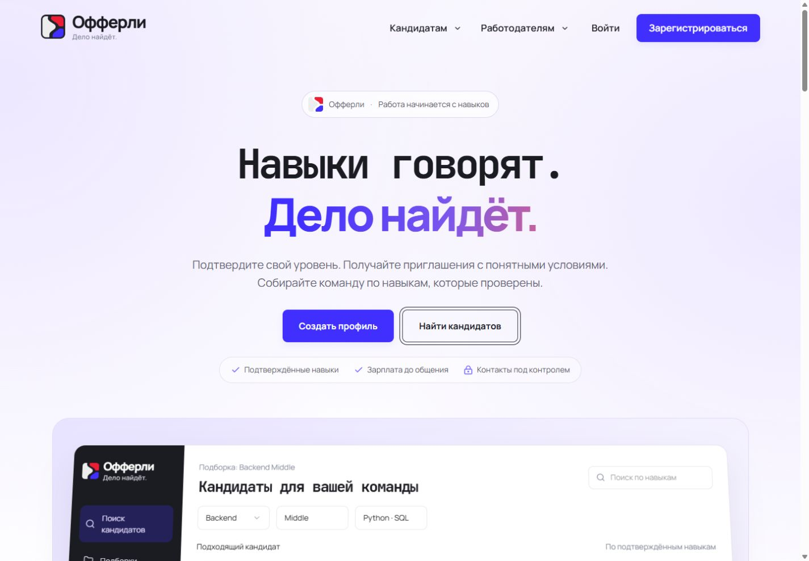

_Два пути входа: кандидат и работодатель._

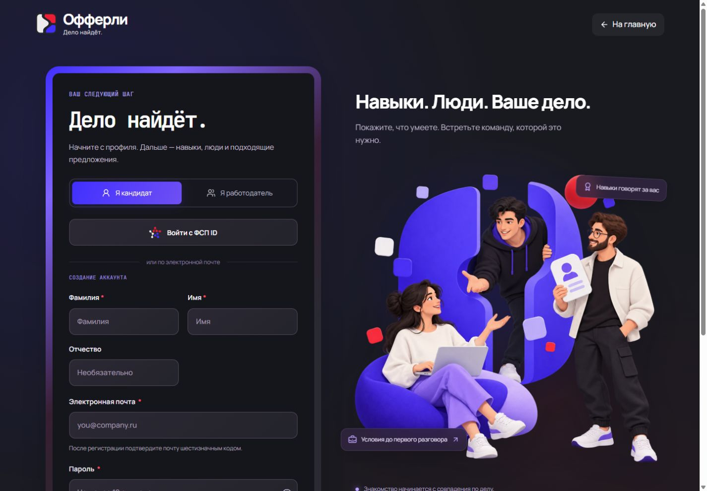

_Роль выбирается при регистрации._

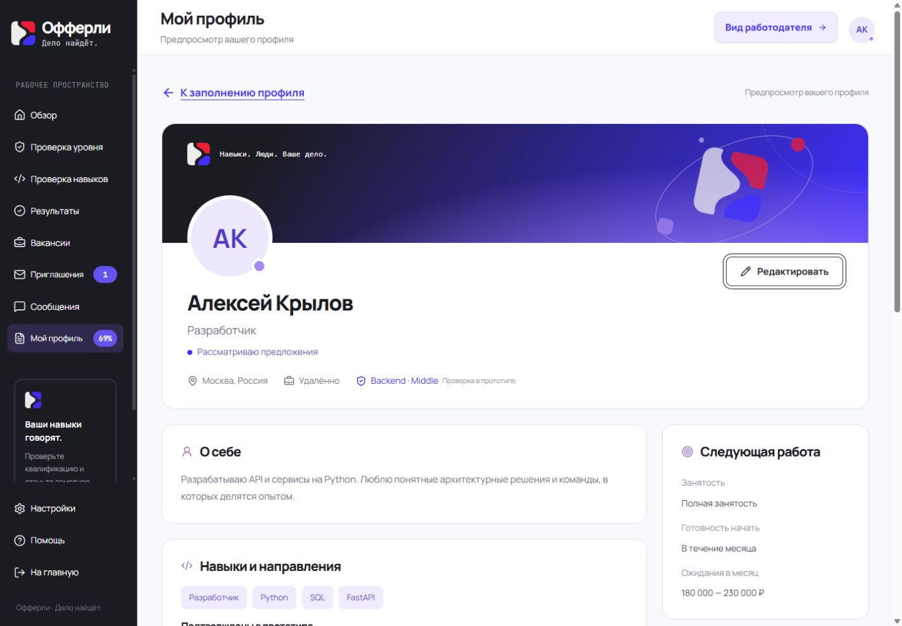

_Это просмотр владельца: здесь видны его демонстрационные контакты и оформление PDF._

</details>

<a name="timing"></a>

## Почему до 20 минут и как определяется грейд

Мы не хотели делать двухчасовой тест: кандидат может не закончить его или к концу отвечать уже на фоне усталости. Но и несколько быстрых вопросов не дадут достаточно оснований для определения грейда. Нам нужен был короткий формат, в котором сохраняется содержательная проверка.

В рамках хакатона у нас нет времени, данных и специальных знаний, чтобы самостоятельно установить необходимую длительность. Поэтому при обосновании формата мы обратились к исследованиям. Работа Mullette-Gillman и соавторов связывает 60–90 минут нагрузки со снижением стабильности решений [1]. Это аргумент учитывать утомление, но для выбора короткого формата нужен более близкий ориентир.

Его даёт работа Krieger и соавторов *Assessing Complex Problem-Solving Skills in Under 20 Minutes* [5]. На данных 232 студентов авторы выделили пять небольших сценариев для исследования сложных задач: по три минуты на поиск связей в каждом, весь сокращённый формат — менее 20 минут. При сокращении сохранились связи результатов с показателями интеллекта и учебными оценками. Для нас полезен принцип: содержательная проверка может состоять из нескольких компактных сценариев разной сложности. При этом авторы прямо не рекомендуют эту короткую шкалу для индивидуальных решений; подтверждение наших грейдов требует собственной проверки.

**Почему именно 20 минут в нашем решении.** Вводный экран уже задаёт следующий бюджет:

| Обязательная часть | Ориентир времени |
| --- | --- |
| Четыре коротких сценария | 3–4 минуты |
| Расследование инцидента | 5–6 минут |
| Ревью решения | 5–6 минут |
| Всего | 13–16 минут |

Это ориентиры интерфейса, а не измеренное время прохождения кандидатами. Они позволяют объяснить выбор ограничения:

| Лимит | Что означает для этой структуры |
| --- | --- |
| 15 минут | Почти весь бюджет занимает обязательная часть; при верхней оценке времени она уже не помещается. Практически нет запаса на уточняющие задания. |
| 20 минут | После обязательной части остаются 4–7 минут на уточнения и переходы. Сохраняются разные типы наблюдений и возможность разобрать неоднозначный результат. |
| 30 минут | Даёт ещё десять минут, но обязательная часть остаётся той же. Пока у нас нет данных, что такое увеличение улучшает определение грейда настолько, чтобы оправдать дополнительное время кандидата. |

Поэтому **20 минут — верхний предел, а не обязательная длительность**. Если обязательная часть завершена и оснований достаточно, проверка заканчивается раньше. Иначе движок добавляет уточнения: максимум шесть для Junior/Middle и пять для Senior, в пределах общего таймера. Мы считаем этот выбор обоснованным для прототипа: короткая содержательная основа плюс запас для адаптации.

Следующий шаг — сравнить лимиты 15, 20 и 30 минут на реальных кандидатах с независимой оценкой их уровня. Нужно проверить долю завершённых тестов, совпадение грейдов и то, меняют ли дополнительные минуты решение. Так можно выяснить, достаточно ли 20 минут для каждого направления и уровня, и скорректировать лимит по результатам.

При оценке учитываются сложность, диагноз, источники и исполнение. Связанные шаги объединяются, чтобы длинный кейс не получал чрезмерный вес. Для подтверждения нужны завершённая обязательная часть и достаточные основания по компетенциям. У старших уровней растёт вес адаптации:

| Уровень | Диагностика | Корректность | Суждение | Адаптация | Порог |
|---|---:|---:|---:|---:|---:|
| Junior | 0,30 | 0,40 | 0,20 | 0,10 | 0,60 |
| Middle | 0,30 | 0,30 | 0,25 | 0,15 | 0,65 |
| Senior | 0,20 | 0,25 | 0,25 | 0,30 | 0,72 |

### Как принимается решение по грейду

Кандидат выбирает уровень, который хочет подтвердить. Движок рассчитывает оценки четырёх компетенций и общий взвешенный результат, затем добавляет расчётный запас неопределённости: он зависит от количества независимых наблюдений и различий между оценками компетенций. Для подтверждения **нижняя граница результата должна быть выше порога**, обязательная часть — завершена, а каждая компетенция — проверена. Поэтому средний балл выше порога сам по себе ещё не подтверждает грейд.

Дополнительные задания направляются прежде всего на компетенции, по которым остаются сомнения. Если независимые кейсы повторно показывают устойчивый дефицит обязательной компетенции, высокие оценки по другим направлениям его не компенсируют. Мы выбрали такое правило, чтобы сильная сторона не скрывала существенный пробел в работе специалиста.

| Итог | Что он означает |
| --- | --- |
| Уровень подтверждён | Обязательная часть завершена, оснований достаточно, нижняя граница выше порога и нет неразрешённого дефицита |
| Уровень не подтверждён: ниже требований | При достаточном покрытии верхняя граница ниже порога либо независимые кейсы подтвердили дефицит обязательной компетенции |
| Уровень не подтверждён: недостаточно оснований | Проверка не дала устойчивого решения: обязательная часть не завершена или результат остался неоднозначным |

При недостатке оснований движок не рекомендует более низкий уровень автоматически. Попытка подтверждает только выбранный грейд; рекомендация попробовать другой уровень не присваивает его кандидату.

Таймер контролирует сервер; перезагрузка не начинает отсчёт заново. К выданным заданиям можно возвращаться и менять ответ. После подтверждения повтор того же направления доступен через 90 дней, после неуспеха того же уровня — через 7 дней. Прежний подтверждённый грейд сохраняется.

<details>
<summary>Посмотреть вводный экран и структуру испытания</summary>

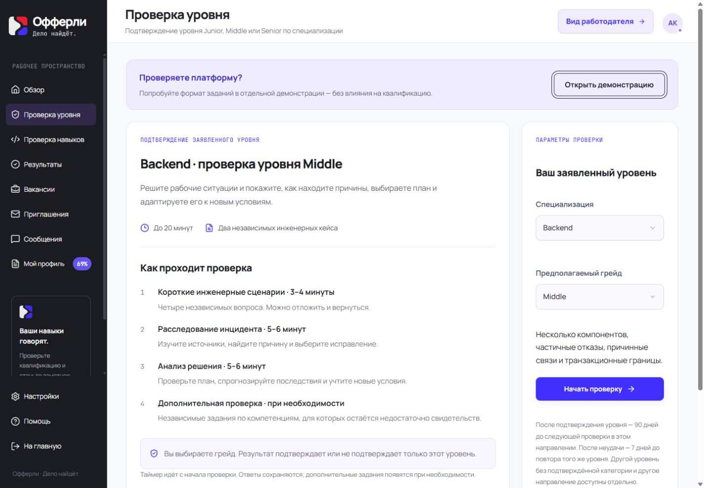

_До начала кандидат видит состав проверки и ориентиры времени._

</details>

<a name="protection"></a>

## Защита от слива заданий и заучивания ответов

Возникла ещё одна проблема: как сохранить смысл проверки, если задания и готовые ответы попадут в интернет. При одинаковой выдаче кандидат может запомнить нужную формулировку, не разобравшись в задаче. Поэтому мы сделали генератор вариантов и контроль предыдущей выдачи. Цель — снизить пользу готового ответа и проверить, способен ли человек применить принцип к новым условиям.

**Меняется сама ситуация.** Генератор строит формальное состояние задачи: события, причинные связи, ограничения и допустимые действия. Из него согласованно получаются условие, код, логи или другие материалы, варианты ответа и серверный эталон. Меняются не только названия и числа: разные начальные значения генерации могут менять причину проблемы и правильное решение. В многошаговых заданиях условия дополнительно изменяются по ходу проверки, после чего эталон пересчитывается.

Например, в Backend-моделях явно различаются эффект в той же базе данных и действие внешнего провайдера. В первом случае отметку обработки и эффект можно зафиксировать одной транзакцией; во втором локальная транзакция не охватывает внешнее действие. Поэтому заученное «добавить транзакцию» нельзя автоматически перенести на похожее условие. Нужно проверить границы операции и гарантии конкретной системы. Структурированный план и прогноз результата дополнительно показывают, умеет ли кандидат применить выбранное решение к отдельным состояниям.

Мы рассчитываем несколько SHA-256-отпечатков:

| Отпечаток | Что он сравнивает |
| --- | --- |
| Смысловой | Модель, грейд, существенное состояние, причину нарушения и структуру системы. Помогает избегать недавних смысловых повторов. |
| Текстовый | Нормализованные условия и материалы. Замена времени или идентификатора операции не делает тот же вариант новым. |
| Отдельного вопроса | Условие шага, ответы, поля плана и видимые материалы; порядок ответов и их случайные ID не влияют на сравнение. |

История хранит уже выданные задания. Часто используемые модели получают меньший приоритет, недавно показанные этому кандидату модели по возможности заменяются другими. Сформированные вопросы активной попытки, включая резерв уточнений, заранее резервируются, чтобы учитывать и одновременную выдачу. Для новой сессии сервер создаёт случайное начальное значение генерации. Это затрудняет получение знакомого набора через повторные попытки; интервалы повторного тестирования также ограничены правилами платформы.

**Эталон остаётся на сервере.** В обычном испытании браузер получает условия и доступные материалы, но не правильные ответы, скрытые проверки плана или баллы каждого варианта. Порядок ответов перемешивается, их ID не обозначают правильность. Экспертное заполнение эталоном доступно отдельно в демонстрации и не подтверждает настоящий грейд.

**Почему разные варианты остаются честными.** Свобода генератора ограничена опубликованными моделями и профилями сложности для каждой специализации и грейда. Сохраняются состав обязательных этапов, проверяемые компетенции и правила оценки; контролируются покрытие предметных областей и независимость семейств задач. Сложность задаётся характером рассуждения: неоднозначностью данных, глубиной причинных связей, ограничениями и ответственностью решения. Новизна не должна разрушать это покрытие, поэтому предпочтение свежим семействам не является безусловным запретом на знакомую тему.

Каждый вариант проходит автоматическую проверку перед выдачей: материалы должны соответствовать состоянию, баллы — формальной модели, а вопрос с одним выбором иметь ровно один лучший ответ. Проверяется наличие допустимого плана; правильный вариант не должен явно выделяться длиной или количеством технических деталей. Некорректный вариант отклоняется. Сохраняются исходный снимок и версии, поэтому можно воспроизвести, что получил кандидат и как оценивался ответ. Так обеспечивается структурная сопоставимость; равную трудность для реальных людей ещё предстоит проверить. Попытка автоматически выравнивать формы по синтетическим оценкам не показала стабильной пользы и не была включена в рабочую выдачу.

<a name="tasks"></a>

## Какие компетенции и задания мы выбрали

С развитием ИИ-помощников всё важнее становится умение проверить готовое решение, понять его ограничения и отвечать за результат. Именно эти компетенции мы хотим оценивать. В рамках хакатона мы не можем самостоятельно установить, какие навыки сегодня важнее для каждой профессии, поэтому при обосновании заданий обратились к исследованиям работы с ИИ.

Lee и соавторы в опросе 319 работников выделяют смещение критического мышления к «проверке информации, интеграции результатов и управлению задачей» [3]. Для нас это основание включить диагностику, ревью и изменение решения при новых условиях: кандидат должен понимать, почему результат работает и когда его нужно пересмотреть.

В результате проверка оценивает **диагностику, корректность, инженерное суждение и адаптацию**. Раздельная оценка показывает, где человек нашёл причину, но ошибся в исправлении, или выбрал рабочее решение, не учтя его последствия.

| Тип задания | Что делает кандидат | Почему это нужно |
|---|---|---|
| Четыре коротких сценария | Выбирает объяснение и действия по наблюдениям | Один знакомый кейс не должен определять весь результат |
| Расследование инцидента | Изучает код, архитектуру и трассировки, объясняет причину | Важно увидеть, на чём основан диагноз; учитывается порядок первых двух источников |
| Проверка гипотезы | Находит факт, опровергающий свою причину | Умение проверить собственный вывод |
| Ревью и план операций | Разбирает готовое решение и выбирает безопасные изменения | Применение решения с учётом контракта и последствий |
| Дополнительные вопросы | Уточняет результат при нехватке оснований для оценки | Не удлинять одинаково каждую попытку |

Например, в Backend-сценарии API возвращает 20 строк, но загружает из базы 80 000. Кандидату нужно по коду определить, что ограничение применяется уже в приложении, и связать это с ростом времени и памяти.

Задания создаёт формальный генератор с серверным эталоном. Мы выбрали его, чтобы проверять согласованность условия и оценки программно: меняются контекст и состояния, но правила решения остаются контролируемыми.

Доступны 12 направлений: Backend, Frontend, DevOps/SRE, QA, Data Engineering, ML Engineer, Data Scientist, MLOps, GenAI, Android, iOS и AppSec. В каждом — Junior, Middle и Senior; для старших уровней выше значение взаимосвязей, рисков и адаптации.

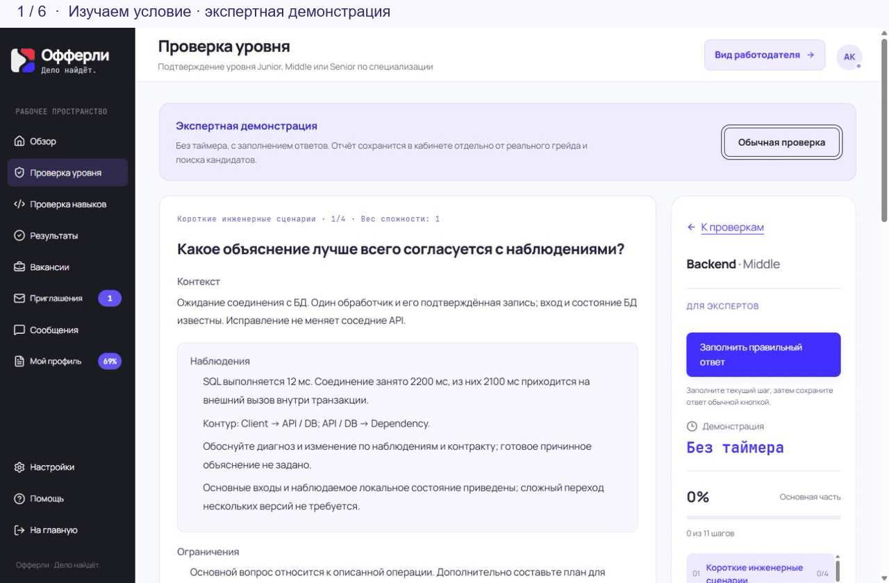

_Этапы проверки в экспертной демоверсии: сценарий, выбор ответа, расследование, анализ решения и отчёт. Демонстрация не подтверждает настоящий грейд._

<details>
<summary>Посмотреть инцидент, ревью, отчёт и экспертную демонстрацию</summary>

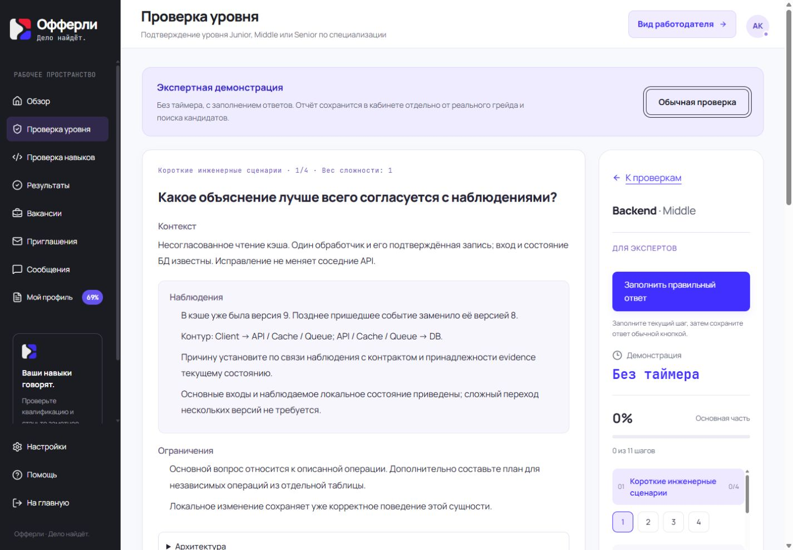

_Кандидат анализирует ситуацию и выбирает действия; выданные вопросы доступны в навигации._

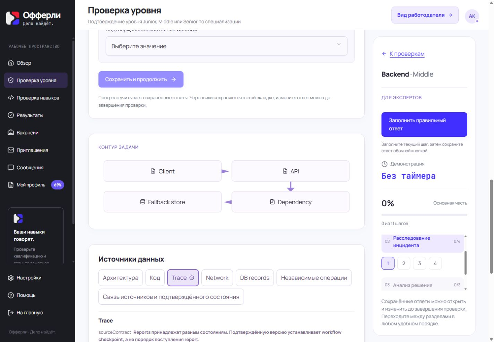

_Код, архитектура и трассировки служат источниками для проверки гипотез._

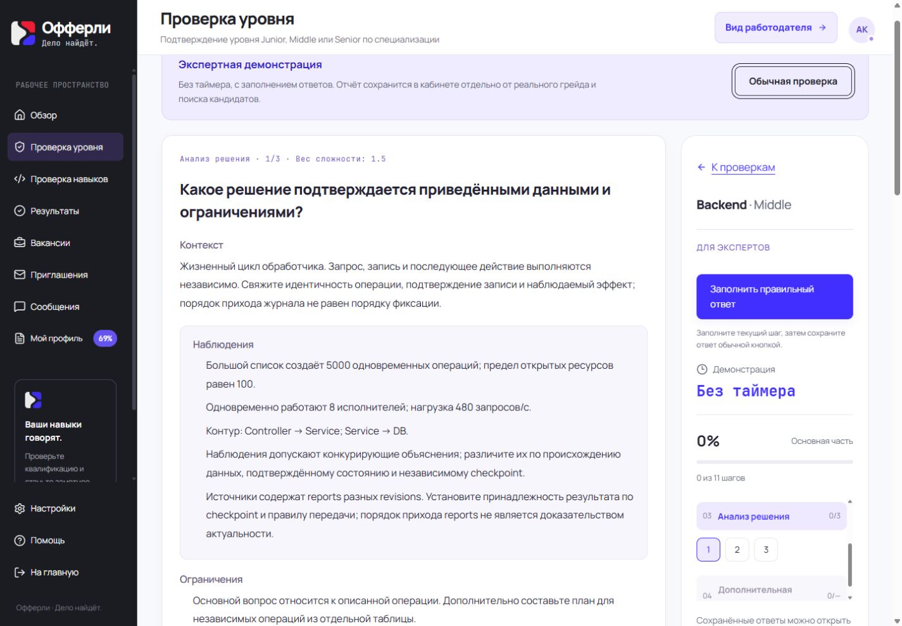

_Проверяются последствия решения и безопасный план изменений._

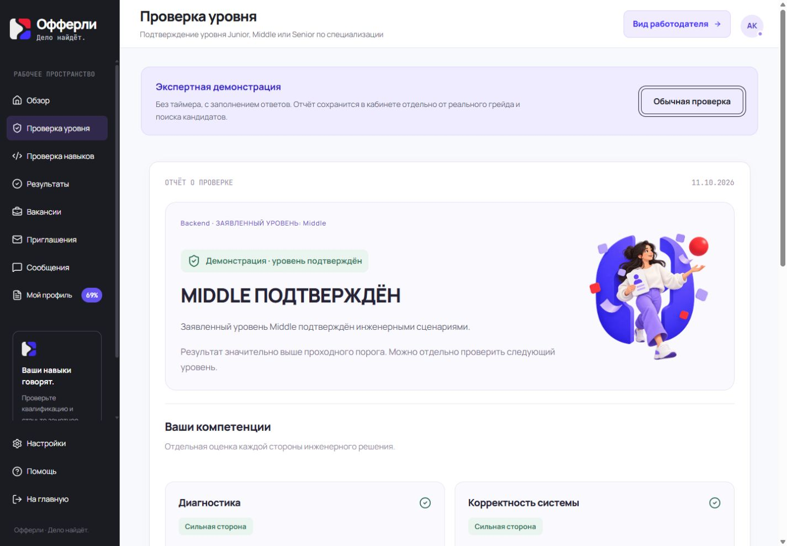

_Сохранённый результат объясняет решение по грейду. На снимке — экспертная демонстрация._

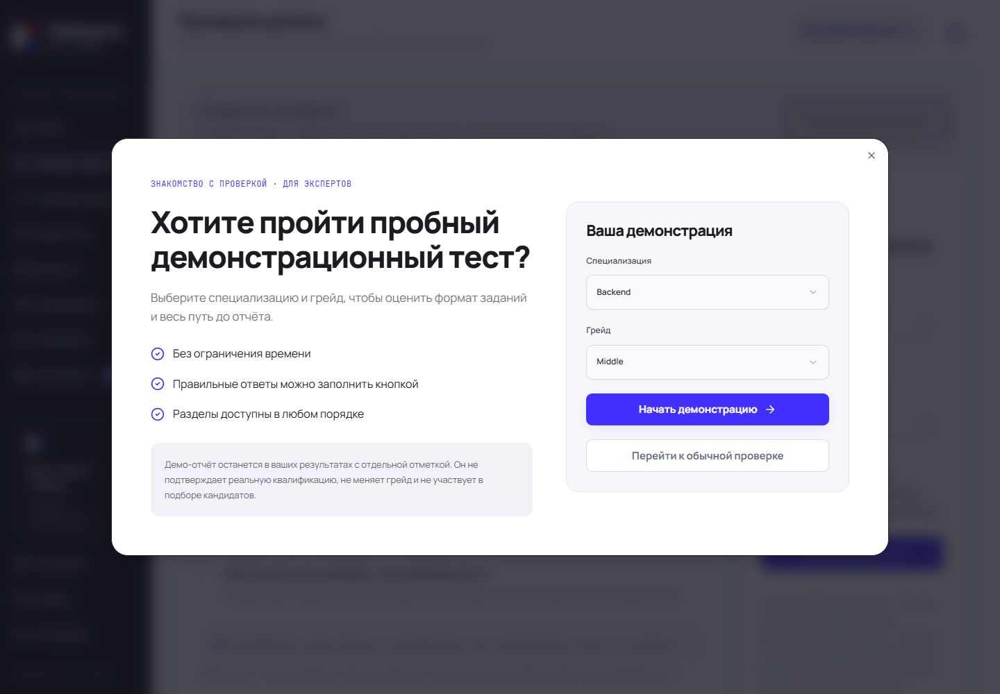

_Все 36 сочетаний специализации и грейда можно изучить без таймера с заполнением эталонного ответа._

</details>

<a name="validation"></a>

## Как мы проверяли методику и что получили

Мы проверяли три вещи: правильно ли работает оценка, различает ли она заданные модельные уровни и можно ли пройти испытание простыми стратегиями обхода. Основная проверка проведена на синтетических моделях поведения, включая пограничные профили и отдельные слабые компетенции.

**Как проводили.** Сначала выбрали алгоритм на данных для настройки. Затем зафиксировали план и параметры и проверили его на новых случайных начальных значениях контрольной серии. После просмотра результатов параметры не подгоняли. Серии с обнаруженной ошибкой передачи плана сохранили как отклонение от протокола; ошибку исправили и добавили проверку хеша плана.

**Объём и результат.** Итоговый отчёт содержит 201 600 синтетических исполнений: 190 080 в контрольной серии и 11 520 в проверке форм. Для выбранного алгоритма в основной серии — 720 прогонов на грейд, по 60 случайных начальных значений в каждой из 12 специализаций.

| Модельный уровень | Подтверждение уровня |
|---|---:|
| Junior | 95,69% |
| Middle | 85,14% |
| Senior | 83,33% |

Результаты относятся к **заданным модельным уровням** и зависят от специализации и раскладки навыков.

Это доля подтверждения заранее заданного уровня модели, а не измеренная точность классификации реальных кандидатов. Контрольные сценарии включали слабые отдельные компетенции и попытки проходить проверку заучиванием или поиском ключевых слов. Такой подход проверяет правила оценивания и поведение движка в воспроизводимых условиях. Независимая оценка людей нужна, чтобы проверить сами основания грейдов.

Воспроизводимость обеспечивают сохранённые начальные значения генерации, снимки задания и версии алгоритма и конфигурации оценки. Описание переноса движка и сохранённые проверки доступны в [документации испытаний](docs/assessment/README.md) и [отчёте верификации](docs/assessment/verification-report.md).


<a name="employer"></a>

## Кабинет работодателя, подбор и MCP

### Кабинет работодателя

 Здесь можно заполнить профиль компании, создавать и публиковать вакансии, просматривать отклики и менять их статусы. Обзор показывает активные вакансии, входящие отклики, ожидающие ответа приглашения и сохранённых кандидатов. В каталоге доступны поиск, избранное и фильтры по специализации, уровню, технологиям, опыту, городу, формату и зарплатным ожиданиям. Работодатель видит источник и дату оценки, различает заявленные и проверенные навыки, сравнивает два–четыре профиля и сохраняет потребности команды для следующего подбора. После согласия кандидата доступны переписка и добровольные задания с критериями, ожидаемым временем и обратной связью.

### От условий команды к кандидатам

В кабинете есть два способа начать поиск: задать фильтры в каталоге или описать потребность команды в «Подборках». Заявленные технологии и подтверждённые навыки различаются; при необходимости работодатель включает отдельное требование к подтверждению. Результат испытания — оценка компетенций по шкале 0–100, а не вероятность успешного найма.

Подбор начинается с задачи команды. Работодатель проверяет условия, извлечённые из описания правилами и словарями: направление, уровни, технологии, бюджет и формат. Обязательные технологии ограничивают выдачу, желательные меняют порядок; альтернативы объединяются в группы «или».

Рейтинг **R = 50T + 25K + 25F** объединяет проверку, соответствие стеку и релевантные достижения ФСП; компоненты нормированы от 0 до 1. Проверке отдали половину веса: она даёт основное основание для оценки компетенций. Веса выбраны нами и ещё не оптимизированы по результатам найма.

**T — результат проверки.** Для подтверждённого грейда берём сохранённую оценку, делённую на 100. При подборе под типы задач используем взвешенную оценку соответствующих компетенций: «Сильная сторона» — 1, «Соответствует» — 0,7, остальные оценки — 0. Веса задаёт сервер по задаче команды. Без подтверждённого грейда T равен 0.

**K — соответствие технологиям.** Совпадение обязательного требования даёт 1, отдельное подтверждение этого совпадения — ещё 0,25, совпадение желательного требования — 0,5. Компонент нормируется: `K = (B + 0,25V + 0,5D) / (1,25N + 0,5M)`, где B — обязательные совпадения, V — подтверждённые среди них, D — желательные совпадения, N и M — число обязательных и желательных требований. Группа альтернатив «или» считается одним требованием. Без требований к технологиям K равен 0; прохождение общего испытания не подтверждает автоматически весь заявленный стек.

**F — релевантные достижения ФСП.** Победа имеет вес 1, призовое место — 0,8, участие — 0,4. Релевантность равна 1 при совпадении направления; иначе — 0,75 при совпадении нужной технологии, 0,5 без заданного направления поиска или 0 в остальных случаях. Считаем `F = min(1, сумма(вес результата × релевантность) / 2)`. Повтор одного события не добавляет бонус. Учитываются подтверждённые источники и явно отмеченные демонстрационные события; свободный текст и один лишь ФСП ID бонуса не дают. Без учитываемых достижений F равен 0, кандидат остаётся доступен для подбора.

В режимах приоритета теста или ФСП используются соответственно `100T` и `100F` с теми же фильтрами. Сравнительные объяснения по компетенциям строятся для одинаковых специализации, подтверждённого грейда и известных версий методики и конфигурации оценки. Так разница между несопоставимыми проверками не превращается в вывод о превосходстве одного кандидата.

Предлагаются варианты под эксплуатацию, продукт, качество, бюджет и достижения — с объяснениями и сравнением двух–четырёх профилей. В сохранённом модельном эксперименте на авторской разметке 36 запросов и 360 пар получены P@5 = 0,80 и nDCG = 0,9165; повторно он не проводился.

### Приглашения, чат и задачи работодателя

Приглашение содержит зарплату; контакты и чат открываются после согласия кандидата. Изменённые условия нужно рассмотреть заново. Переписка сохраняется, повторы запросов не создают дубликаты. Письма отправляются через SMTP-очередь с повторными попытками, чтобы сбой почты не отменял действие пользователя.

### MCP для ИИ-помощника работодателя

 Мы реализовали сервер Model Context Protocol, через который подключённый агент может выполнять поручения работодателя: искать кандидатов, получать сокращённый профессиональный профиль и готовить черновик приглашения. Доступны три инструмента: search_candidates, get_candidate_profile и draft_invitation. Они используют тот же каталог и правила ранжирования, что и кабинет. В настройках можно получить конфигурацию подключения, создать, заменить или отозвать токен.

| Инструмент | Назначение |
| --- | --- |
| `search_candidates` | Поиск с фильтрами и приоритетом ранжирования; до 20 профилей на странице |
| `get_candidate_profile` | Получение сокращённого профессионального профиля доступного кандидата |
| `draft_invitation` | Подготовка черновика с текстом, зарплатной вилкой и ключом повторного запроса |

В черновике обязательна зарплатная вилка. Работодатель проверяет текст и условия в кабинете, затем одобряет отправку или удаляет черновик. Токен агента не позволяет подтвердить отправку; перед одобрением сервер повторно проверяет доступность кандидата. Такой порядок сохраняет контроль человека над предложением и позволяет поручить агенту поиск и подготовку.

### Персональные данные и 152-ФЗ

 Через MCP передаются только ID, специализация, грейд, проверенные технологии, результат испытания, агрегированные сведения ФСП и компоненты рейтинга. ФИО, контакты, резюме, свободный текст профиля и переписка в ответ не включаются. Каждый запрос проверяет токен, членство работодателя в компании, область доступа и доступность профиля, включая флаги согласия и видимости. Изменения согласий записываются; закрытые контакты доступны работодателю только после согласия кандидата на общение. Токен можно отозвать, его копируемое значение хранится зашифрованным AES-256-GCM.

Эти меры реализуют ограничение состава передаваемых данных и контроль доступа с учётом [152-ФЗ «О персональных данных»](https://mintrud.gov.ru/docs/laws/130). Бэкенд и локальный MCP-мост сами не обращаются к внешним нейросетям; обработка данных подключённым ИИ-клиентом зависит от выбранного работодателем решения. Сокращённый профиль может оставаться персональными данными. Полное соответствие 152-ФЗ при работе с реальными людьми требует также правового основания, корректных согласий, документов оператора, проверки локализации и условий передачи данных выбранной модели.

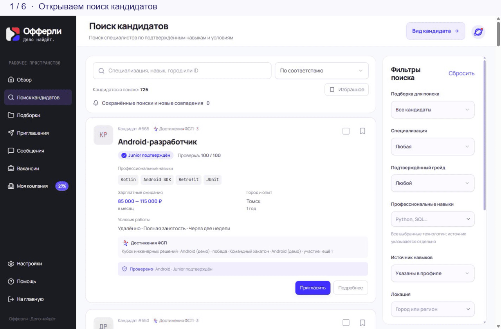

_Поиск, выбор двух кандидатов, сравнение параметров и различий, просмотр профиля и подготовка предложения на демонстрационных данных._

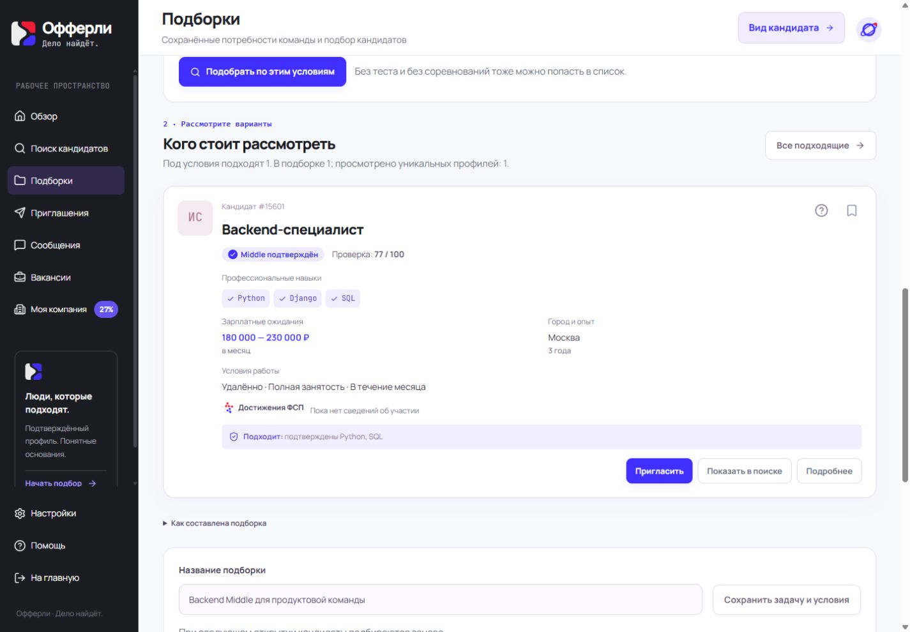

_Сохранённые условия и варианты подбора с разными акцентами._

<details>
<summary>Посмотреть обзор, вакансии, условия и объяснения подбора</summary>

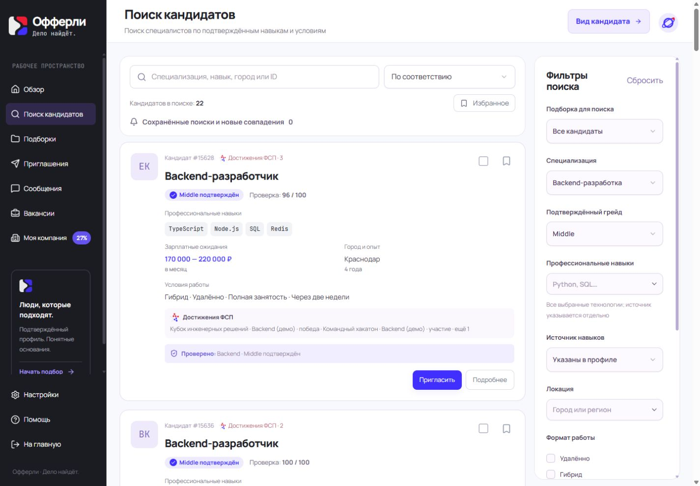

_Фильтры, источник оценки и карточки специалистов; сравнение доступно для двух–четырёх профилей._

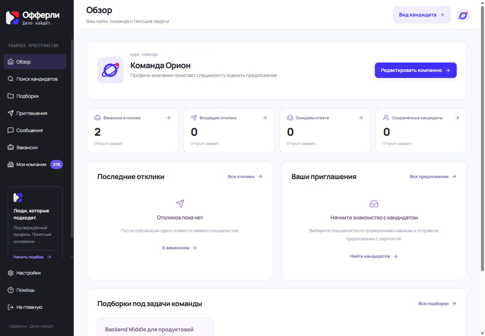

_Сводка вакансий, откликов, приглашений и сохранённых кандидатов._

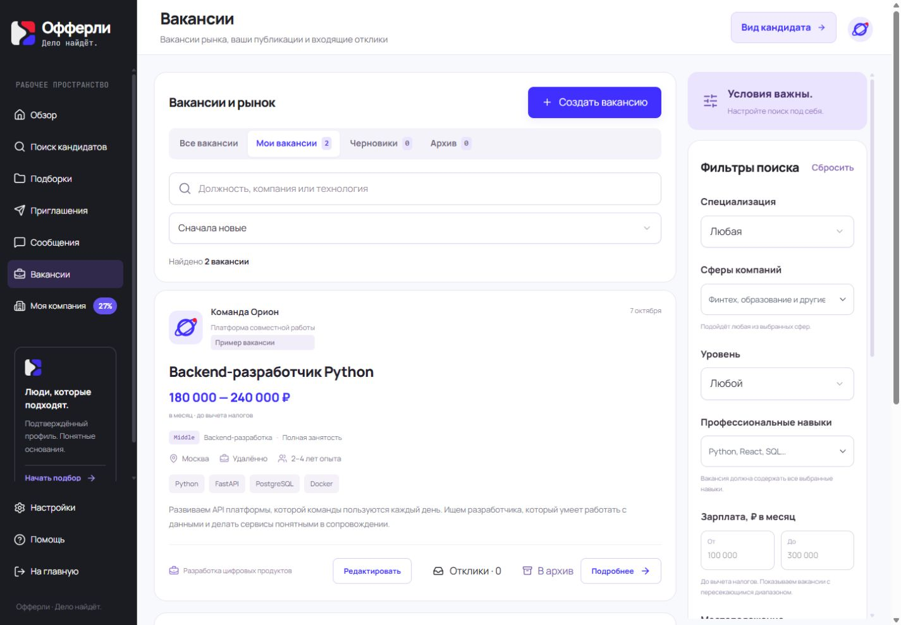

_Вакансии с зарплатой и требованиями, редактирование и переход к откликам._

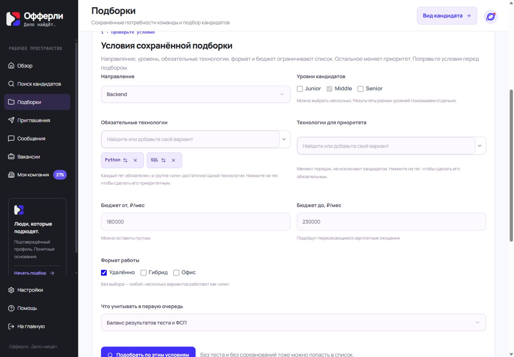

_Работодатель проверяет и редактирует интерпретацию своей задачи._

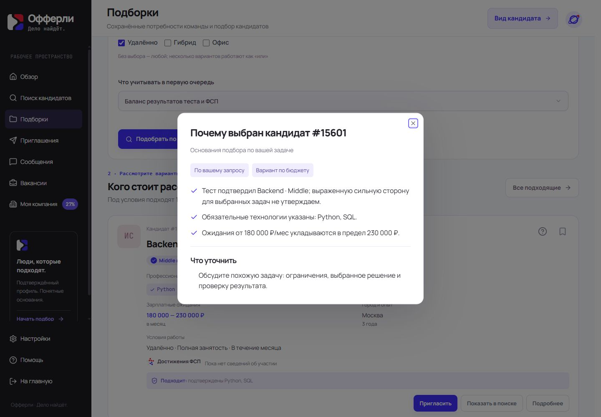

_Объяснение использует данные профиля, проверку и релевантные достижения._

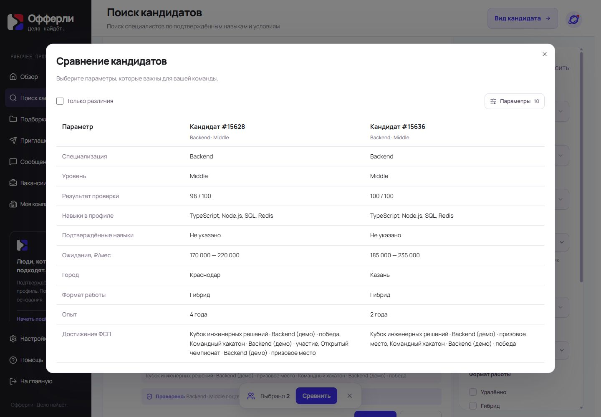

_Направление, грейд, компетенции и условия видны рядом._

</details>

<details>
<summary>Посмотреть приглашение, согласие кандидата и чат</summary>

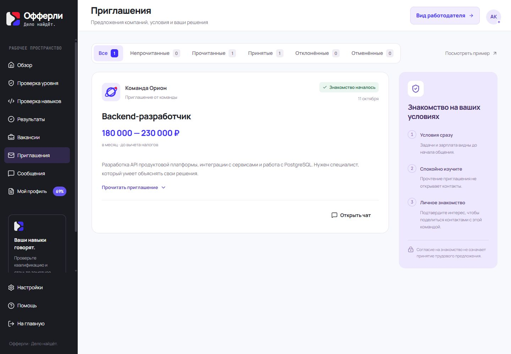

_Кандидат видит предложение и зарплатную вилку до ответа._

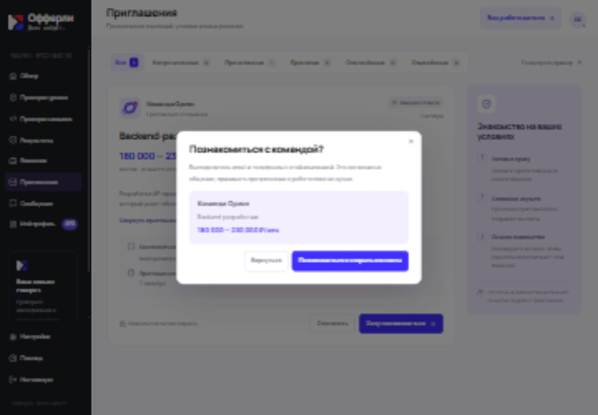

_Перед принятием интерфейс объясняет, какие контакты получит конкретная компания._

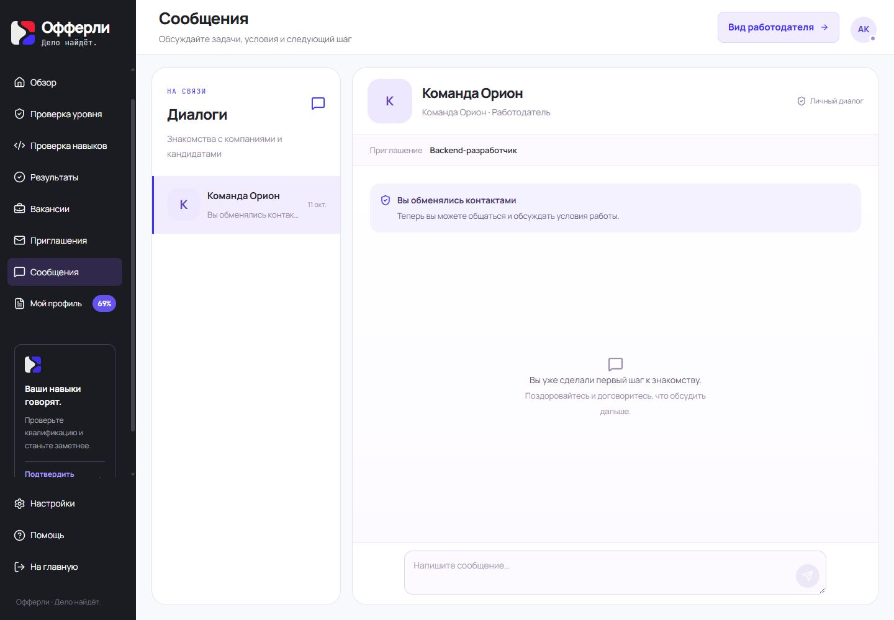

_История разговора сохраняется; доступ проверяется сервером._

</details>

<a name="architecture"></a>

## Архитектура, API и интеграция с ФСП

Мы выбрали **модульный монолит**: интерфейс, HTTP API и предметная логика развёртываются одним приложением, а подсистемы имеют отдельные модули. В рамках хакатона это уменьшает число сервисов для поддержки и позволяет согласованно сохранять результат испытания, приглашение, доступ к контактам и беседу в одной БД.

### Стек и ответственность компонентов

| Слой | Реализация | Ответственность |
| --- | --- | --- |
| Интерфейс | Next.js 16, React 19, TypeScript, Tailwind CSS 4, Radix / Base UI | Кабинеты, формы, навигация, каталог и отображение результатов |
| Сервер | Node.js 22, Next.js Route Handlers, Zod | Входные данные, сессия, права, операции и публичные ответы |
| Хранение | PostgreSQL 16; PGlite в локальной разработке | Профили, каталог, попытки, согласия, вакансии, приглашения и сообщения |
| Профессиональное испытание | `vendor/fsp-assessment`, серверный мост `lib/professional-assessment.ts` | Генерация, адаптация, эталоны и расчёт компетенций |
| Подбор | `lib/catalog.ts`, `lib/employer-matching.ts`, `lib/task-brief.ts`, `lib/task-recommendations.ts` | SQL-поиск, интерпретация условий, рейтинг и объяснения |
| Файлы и PDF | Приватный том, Sharp, отдельный worker с unpdf; jsPDF для экспорта | Импорт резюме, изображения и PDF-профиль |
| Почта | Nodemailer, очередь приглашений, сменяемый SMTP-транспорт | Коды, уведомления и повторные попытки доставки |
| Интеграции | OIDC / Keycloak, MCP, OpenAPI 3.0.3 | Идентификация, работа ИИ-помощника и контракт HTTP API |
| Развёртывание | Docker Compose, Caddy, HTTPS | БД → миграции → приложение; на VPS — две копии приложения |

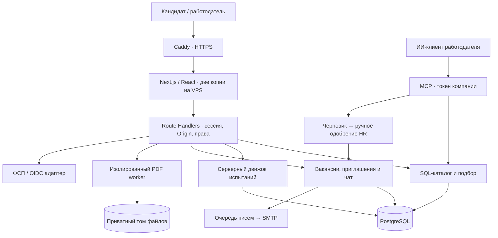

### Данные и согласованность

Слой `db/index.ts` предоставляет общий интерфейс запросов и транзакций. В production требуется `DATABASE_URL` и внешняя PostgreSQL. Без него в разработке используется PGlite в `.data/postgres`, рассчитанная на один процесс. SQL-миграции находятся в `db/migrations/`; production-приложение не меняет схему во время пользовательского запроса.

Профили хранятся вместе с подготовленными полями каталога: `catalog_payload`, признаком `catalog_eligible` и индексом доступных записей. Поиск и ранжирование выполняются в БД, поэтому для выдачи страницы не нужно загружать все резюме. При изменении профиля поисковые поля пересчитываются.

Записи движка испытаний сохраняются в `professional_assessment_records`: область данных, владелец, тип записи и снимок состояния. `TransactionAssessmentStore` адаптирует синхронный движок к транзакции PostgreSQL. Изменение попытки, истории выдачи и результата фиксируется согласованно; блокировки `FOR UPDATE` защищают связанные операции от конкурирующих запросов. Для завершённых попыток сохраняется публичное представление, чтобы просмотр истории не пересобирал весь внутренний снимок.

Демонстрационные данные отделены областью доступа; экспертные попытки используют отдельный контекст и коллекцию. Их завершение не записывает реальное подтверждение в профиль кандидата.

### Связи основных данных

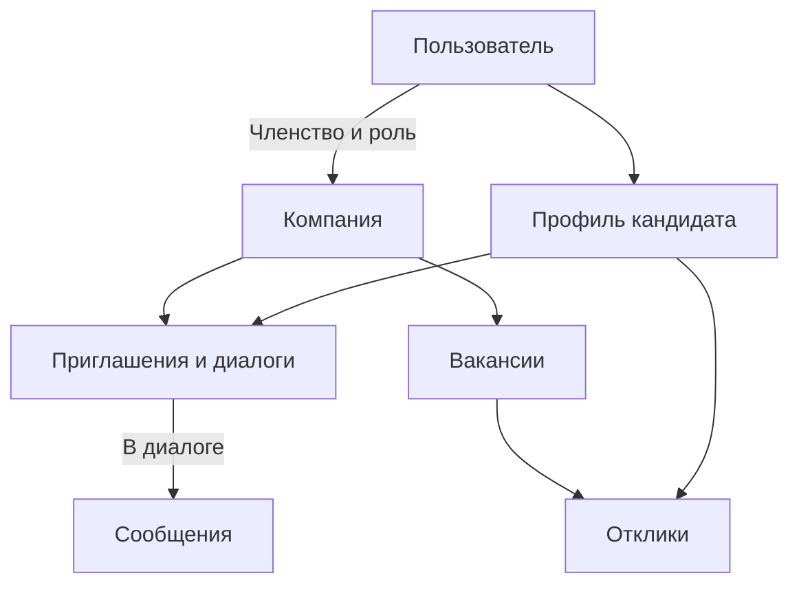

Стрелки показывают связи записей, а права доступа проверяет сервер. Приглашение связывает компанию с кандидатом и не требует опубликованной вакансии; отклик относится к конкретной вакансии. Для пары «компания — кандидат» хранится один диалог.

| Отдельные записи | Связь и назначение |
| --- | --- |
| Попытки и результаты | Принадлежат пользователю; сохраняют состояние и конфигурацию проверки отдельно от текущего профиля |
| События согласия | Содержат пользователя, цель, версию и контекст конкретного действия |
| Потребности команды | Принадлежат компании; сохраняют условия для подбора |
| MCP-черновики | Связаны с работодателем, компанией и кандидатом; после одобрения связаны с отправленным приглашением |

### Сбои, повторы и параллельные действия

Для приглашений сервер проверяет версию условий: устаревшая вкладка получает конфликт, вместо того чтобы перезаписать новое предложение или принять прежние условия. Сообщения имеют уникальный ключ «диалог — отправитель — идентификатор запроса»; повтор отправки с тем же содержимым не создаёт второе сообщение. Эти правила работают через общую БД, независимо от того, какой экземпляр приложения принял запрос.

Уведомление о новом приглашении ставится в очередь в той же транзакции, что и приглашение. Сбой SMTP не отменяет приглашение: обработчик повторяет доставку с растущей задержкой. Несколько обработчиков забирают разные записи через `FOR UPDATE SKIP LOCKED`; запись временно закрепляется за обработчиком, а после истечения этого срока может быть подобрана снова. Так очередь продолжает работу после сбоя одного процесса.

### Как обрабатывается ответ кандидата

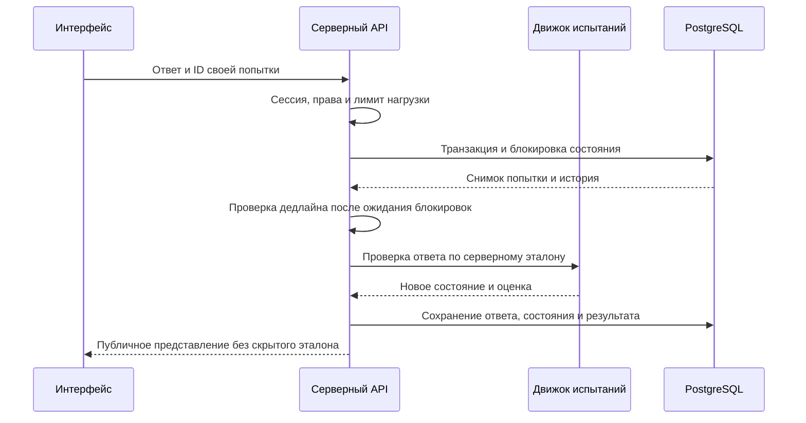

Клиент не рассчитывает подтверждённый грейд. Сервер проверяет дедлайн и допускает пересмотр выданных ответов по правилам навигации. Если данные позволяют закончить проверку, движок формирует итог; иначе выдаёт уточнение в пределах общего бюджета. Версии генератора и оценки сохраняются с попыткой.

**Когда время истекло.** Сервер закрывает попытку и сохраняет результат; уже принятые ответы остаются. Неотвеченные выданные задания получают нулевой вклад в оценку, но не записываются как ответы кандидата. В отчёте сохраняется число отвеченных и пропущенных шагов. Дедлайн проверяется после получения блокировок БД, поэтому запрос, пришедший вовремя, но обработанный после окончания лимита, не позволяет продлить проверку.

**Когда методика обновляется.** Конфигурация оценки фиксируется внутри попытки. Завершённые результаты сохраняются и не пересчитываются при просмотре. Если активной попытке нужна другая версия генератора, сервер возвращает конфликт `409` с объяснением, вместо продолжения новым генератором. Это защищает условия начатой проверки от незаметной смены методики.

### Контракт HTTP API

API принимает JSON; изображения, резюме и другие файлы обслуживаются отдельными маршрутами. Роль и владелец проверяются на сервере, а клиент получает только разрешённое представление данных.

| Группа | Назначение |
| --- | --- |
| `/api/auth`, `/api/sessions` | Вход, подтверждение почты, восстановление и управление сеансами |
| `/api/state`, `/api/action` | Состояние кабинета и действия платформы |
| `/api/catalog/candidates`, `/api/catalog/jobs` | Фильтры, порядок выдачи и пагинация |
| `/api/task-brief`, `/api/recommendations` | Интерпретация задачи и объяснимый подбор |
| `/api/professional/adaptive-sessions` | Профессиональные попытки, ответы и результат |
| `/api/conversations`, `/api/hiring` | Переписка и процессы взаимодействия |
| `/api/identity/fsp` | Привязка внешней идентичности и история ФСП |
| `/api/mcp`, `/api/mcp/settings`, `/api/mcp/drafts` | Инструменты агента, управление доступом и черновики |
| `/api/health` | Проверка состояния приложения и БД |

Сервер различает неверные данные, отсутствие входа и прав, конфликт состояния и превышение нагрузки. [OpenAPI](docs/api/openapi.json) содержит 41 путь; отдельные схемы пока неполны. Дополнительные пояснения: [действия API](docs/api/api-actions.md).

### Безопасность и границы доступа

Пароли хешируются scrypt; токен сессии хранится в БД как хеш, браузер получает HttpOnly cookie. Изменяющие запросы проверяют Origin, сервер контролирует роль, владельца и текущий доступ. Для кодов подтверждения и запросов применены ограничения; предусмотрена CSP. Контакты удаляются из ответа до отправки браузеру, если компания ещё не получила разрешение кандидата.

Runtime-роль PostgreSQL не имеет прав администратора и изменения схемы. Миграции выполняет отдельный одноразовый сервис с другими полномочиями. У БД нет публичного порта; приложение работает без root, с файловой системой только для чтения, отключёнными capabilities и ограниченными временными каталогами. Пользовательские файлы находятся в приватном томе.

PDF разбирается в отдельном worker с лимитами 10 МБ, 40 страниц, 250 000 символов и временем выполнения. Это позволяет завершить тяжёлый разбор, не занимая основной процесс бесконтрольно. Основной импорт выполняется локально по правилам и не отправляет резюме внешней модели.

### MCP: транспорт и полномочия

HTTP-маршруты реализуют протокол; `scripts/mcp-stdio.mjs` предоставляет stdio-мост, а `scripts/mcp-local-gateway.mjs` — локальный шлюз. Авторизация в `lib/mcp-auth.ts` проверяет токен и текущее членство в компании. `lib/mcp-tools.ts` задаёт явный список инструментов и сокращённые ответы, `lib/mcp-drafts.ts` обрабатывает черновики. Произвольный SQL и действия платформы через агентский токен недоступны.

Повтор создания черновика использует тот же `requestId`, чтобы сетевой повтор не создавал новое предложение. Одобрение требует браузерной сессии работодателя и проверки Origin; агентский токен не заменяет это действие. Бэкенд и локальный мост сами не вызывают нейросеть — модель выбирает подключающийся клиент.

### ФСП и идентификация

Действующий API ФСП не предоставлен, поэтому подготовлены адаптер и демонстрационный реестр: ID участника, события, направления, технологии и результаты с источником. Отсутствие истории отличается от ошибки источника.

Для Keycloak реализован OIDC Authorization Code с PKCE, проверкой подписи, одноразовым state и привязкой к браузеру. Идентичность связывается по `issuer + subject`; автоматического объединения аккаунтов по совпавшему email нет. Вход не добавляет человеку грейд или достижения. Реальное подключение потребует согласовать контракт и доступ. [Схема подключения ФСП](docs/guides/fsp-id.md).

### Где находится код

```text
app/                      страницы и HTTP API
components/               интерфейс кабинетов и испытаний
lib/                      предметная логика, доступ и интеграции
db/                       слой БД и SQL-миграции
vendor/fsp-assessment/    формальный генератор и оценка
scripts/                  сборка, миграции, worker и MCP-мосты
qa/                       проверки и сохранённые результаты
deploy/                   конфигурация VPS и Caddy
docs/                     методика, контракты и технические инструкции
```


<a name="running"></a>

## Запуск, нагрузка и эксплуатация

### Быстрый запуск через Docker

 Нужны Git, работающий Docker Engine / Docker Desktop и Compose v2. Для Docker Desktop сначала выполните docker desktop start. Затем выполните в PowerShell или Bash:

```sh
git clone https://gitverse.ru/Yujir0k/redsite.git offerly
cd offerly
docker run --rm -v "${PWD}:/workspace" -w /workspace node:22-bookworm-slim node scripts/setup-docker.mjs
docker compose --env-file .env.docker up --build -d
```

Первая Docker-команда создаёт .env.docker со случайными паролями БД. Вторая собирает приложение, запускает PostgreSQL и применяет миграции. Устанавливать Node.js и зависимости на компьютер не требуется. Конфигурация включает синтетические демо-данные; внешний SMTP, MCP и OIDC по умолчанию отключены. После запуска откройте [localhost:3000](http://localhost:3000) и нажмите «Посмотреть демоверсию».

Если порт 3000 занят, вместо последней команды выполните:

```sh
docker compose --env-file .env.docker run --build -d -p 127.0.0.1:3001:3000 -e APP_URL=http://localhost:3001 app
```

В этом случае откройте [localhost:3001](http://localhost:3001). APP_URL должен совпадать с адресом в браузере.

<details>
<summary>Проверка запуска и команды управления</summary>

```sh
docker compose --env-file .env.docker ps
docker compose --env-file .env.docker logs --tail 100 app migrate
curl http://localhost:3000/api/health
docker compose --env-file .env.docker down
```

Успешный health-ответ: `{"status":"ok"}`. Для альтернативного порта используйте `http://localhost:3001/api/health`. Команда `down` останавливает обычный Compose-стек, сохраняя именованные тома БД и файлов. Контейнер, запущенный через альтернативный `run`, останавливается отдельно: `docker compose --env-file .env.docker down --remove-orphans`. Флаг `-v` удаляет тома: его не используйте для нужных данных.

Запуск проверен на свежем клоне: сборка, миграции, здоровое состояние приложения и БД, демо-кабинеты обеих ролей и каталог кандидатов. При занятом порте 3000 проверен вариант с портом 3001 и соответствующим `APP_URL`.

</details>

### Работа с большим числом пользователей

 На VPS развёрнуты две копии приложения с общей PostgreSQL и файловым хранилищем, HTTPS и проверками состояния. Общая БД сохраняет согласованность данных при обращении к разным экземплярам приложения. Используем пул до 20 соединений на процесс, транзакции и блокировки: параллельные действия не должны создавать повторные попытки и приглашения.

Поиск и сортировка выполняются в БД, каталог выдаётся страницами по 20 записей. Для отбора и рейтинга подготовлены компактные поисковые поля и индекс доступных профилей: большие тексты резюме не приходится обрабатывать для каждой строки поиска. Изменение профиля сразу обновляет поисковые поля. При вводе запроса интерфейс отменяет предыдущий запрос и защищается от запоздавшего ответа.

Чтобы контролировать память и вычислительную нагрузку, тяжёлые операции испытаний ограничены двумя активными слотами на процесс и очередью до 16 ожидающих запросов. Кеш резервных наборов заданий хранит максимум два сочетания специализации и уровня. Для завершённых испытаний сохраняются готовые публичные представления, а большие внутренние снимки истории загружаются последовательно. Разбор PDF вынесен в отдельный воркер с ограничениями размера и времени; письма отправляются через очередь с повторными попытками.

### Нагрузочное тестирование

 На публичном HTTPS-стенде проверили чтение каталогов, кабинетов кандидата и работодателя и главной страницы при 50, 100 и 200 активных виртуальных клиентах с паузой в одну секунду после ответа. Всего выполнено **4 616 запросов, ошибок — 0**.

| Виртуальные клиенты | Запросы | p95, мс | Ошибки |
|---:|---:|---:|---:|
| 50 | 880 | 317 | 0 |
| 100 | 1 640 | 469 | 0 |
| 200 | 2 096 | 1 742 | 0 |

p95 — время, быстрее которого завершились 95% запросов. Дополнительно в локальном production Docker провели трёхминутный смешанный прогон с восемью отдельными тестовыми аккаунтами: каталоги, поиск, состояние кабинета, список диалогов и чтение/запись черновиков. Выполнено **2 146 запросов без ошибок**.

### Дополнительные возможности

Работают вакансии и добровольные отклики, задача работодателя с лимитом 1–120 минут и ручным просмотром результата, адаптивная вёрстка. Автоматический цикл регулярных заданий не завершён; ATS остаётся направлением развития.

Экспертная демонстрация открывает все 36 испытаний без таймера с заполнением эталонного ответа; отчёт не меняет настоящий профиль. Добавлены подбор с разными акцентами, сравнение и свободная навигация. MCP для поиска и подготовки приглашений [описан выше](#employer). Backup выполняется дважды в неделю, хранятся три архива; восстановление проверялось. Копии пока находятся на том же VPS.

### Развёртывание и сопровождение

Dockerfile собирает серверный движок испытаний, PDF worker и standalone-приложение Next.js. Compose запускает здоровую PostgreSQL, затем миграции, после их успешного завершения — приложение. БД и файлы остаются в именованных томах.

Для VPS подготовлены `.env.vps.example`, `deploy/compose.vps.yml` и `deploy/Caddyfile.example`. В окружении задаются домен, отдельные пароли администратора миграций и runtime-роли, параметры SMTP и включаемых интеграций. Caddy завершает HTTPS и направляет запросы в две копии одного релиза. Экземпляры используют общую БД и приватный файловый том; журналы контейнеров имеют ротацию.

В репозиторий не включаются секреты, реальные аккаунты, БД и пользовательские файлы. Инструкции: [почта](docs/guides/production-mail.md), [проверка production-развёртывания](docs/guides/production-checklist.md), [резервные копии](docs/guides/minimal-backups.md).

<details>
<summary>Проверки для изменений кода</summary>

Проект содержит `package-lock.json`; Docker собирается через `npm ci`. После установки зависимостей доступны:

```sh
npm run check:types
npm run check:api
npm run test:regression
npm run test:security
npm run test:expert-demo
```

Это проверки типов, контракта API, доступа и основных сценариев, ограничений безопасности и экспертной демонстрации. Состав проверок и дополнительных прогонов находится в `package.json` и `qa/`.

</details>


<a name="research"></a>

## Что осталось проверить и источники

Приоритеты: пилот на реальных кандидатах для проверки времени и грейдов, независимая оценка подбора, полные схемы API, история опроса для новых пользователей.

**[1] Утомление.** Mullette-Gillman O. A., Leong R. L. F., Kurnianingsih Y. A. (2015). *Cognitive Fatigue Destabilizes Economic Decision Making Preferences and Strategies*. PLOS ONE, 10(7), e0132022. [Статья](https://doi.org/10.1371/journal.pone.0132022).

**[2] Разнообразие выдачи.** Sun X., Gao Y., Xin T., Song N. (2021). *Binary Restrictive Threshold Method for Item Exposure Control in Cognitive Diagnostic Computerized Adaptive Testing*. Frontiers in Psychology, 12, 517155. [Статья](https://doi.org/10.3389/fpsyg.2021.517155).

**[3] Работа с ИИ.** Lee H.-P. H. и соавторы (2025). *The Impact of Generative AI on Critical Thinking: Self-Reported Reductions in Cognitive Effort and Confidence Effects From a Survey of Knowledge Workers*. CHI '25. [Статья](https://doi.org/10.1145/3706598.3713778), [PDF автора](https://hankhplee.com/papers/genai_critical_thinking.pdf).

**[4] Многоэтапное тестирование.** Sideridis G., Ghamdi H., Zamil O. (2023). *Contrasting multistage and computer-based testing: score accuracy and aberrant responding*. Frontiers in Psychology, 14, 1288177. [Статья](https://doi.org/10.3389/fpsyg.2023.1288177).

**[5] Короткие сценарии.** Krieger F., Stadler M., Bühner M., Fischer F., Greiff S. (2021). *Assessing Complex Problem-Solving Skills in Under 20 Minutes*. Psychological Test Adaptation and Development, 2(1), 80–92. [Статья](https://doi.org/10.1027/2698-1866/a000009), [открытый PDF](https://epub.ub.uni-muenchen.de/84293/1/2698-1866_a000009.pdf).

Приложены оригиналы пяти статей: [1–4] — **CC BY 4.0**, [5] — **CC BY-ND 4.0**. Обе лицензии допускают коммерческое распространение с атрибуцией; CC BY-ND требует сохранять оригинал без изменений. [Условия CC BY](https://creativecommons.org/licenses/by/4.0/), [CC BY-ND](https://creativecommons.org/licenses/by-nd/4.0/) и [полная библиография с оригинальными PDF](docs/readme/research/README.md). В README добавлены 20 снимков демонстрационных кабинетов в компьютерной версии.

[Сопроводительная документация в PDF](docs/readme/offerly-documentation.pdf) · [Текст документации](docs/readme/offerly-documentation.md) · [Все технические материалы](docs/README.md)

## Презентация

[Открыть презентацию в PDF](docs/hackathon-presentation/presentation.pdf)

<details>
<summary>Листать презентацию прямо в README</summary>

<p align="center">
  
  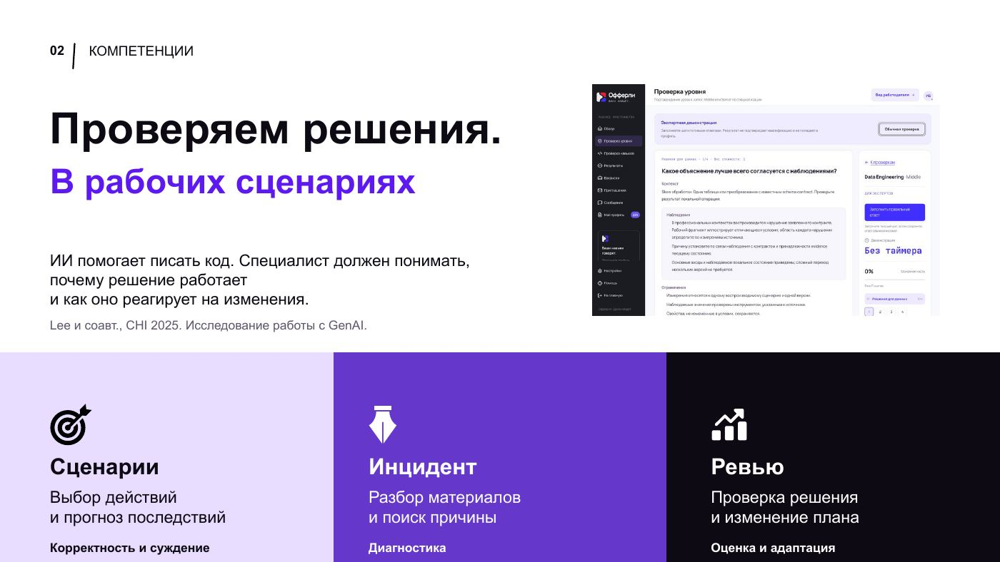
  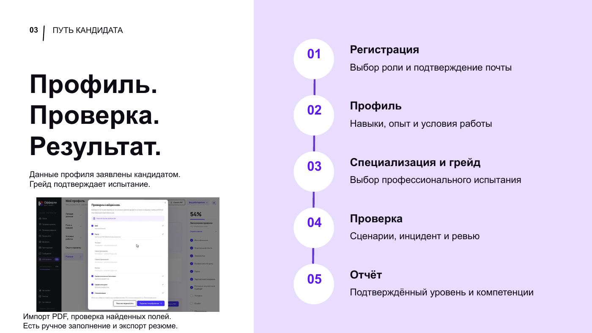
  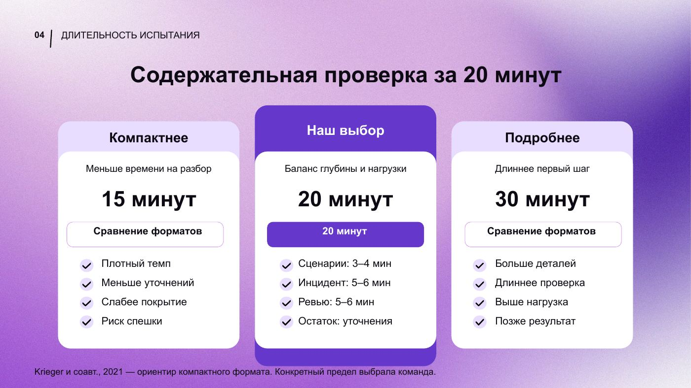
  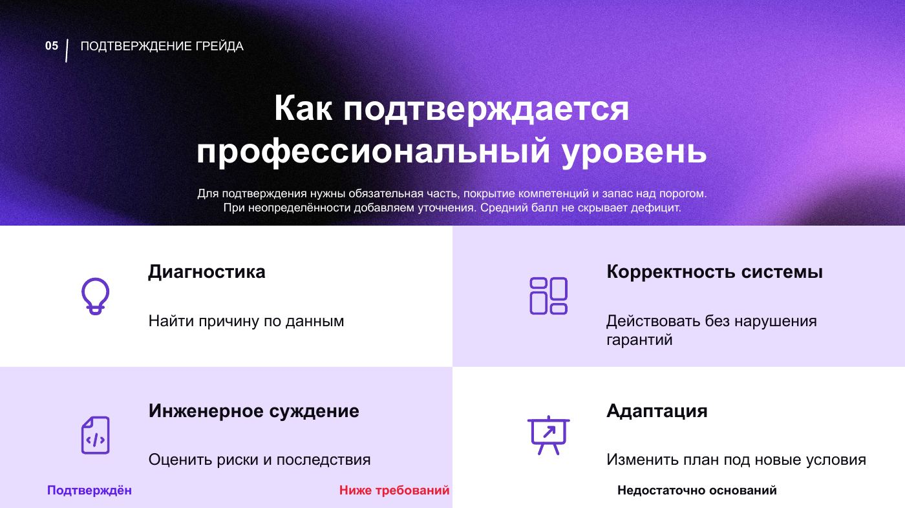
  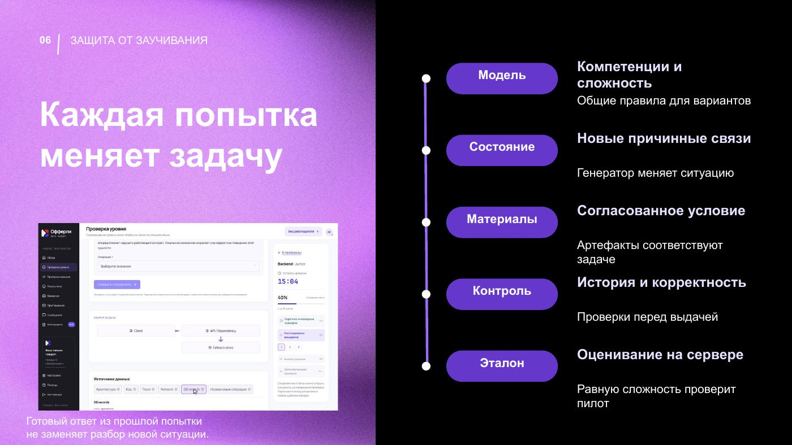
  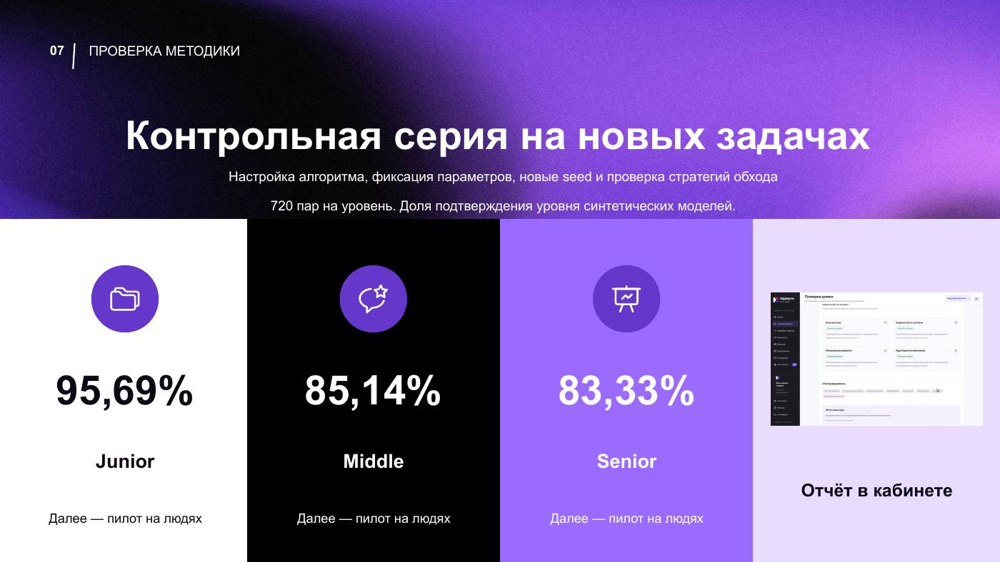
  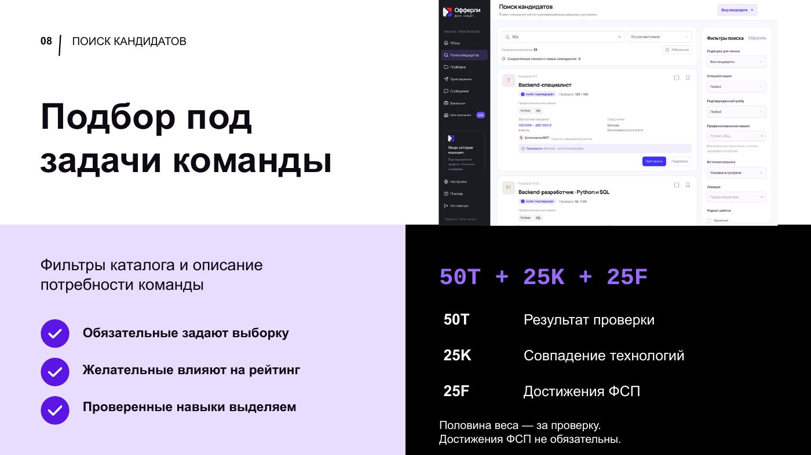
  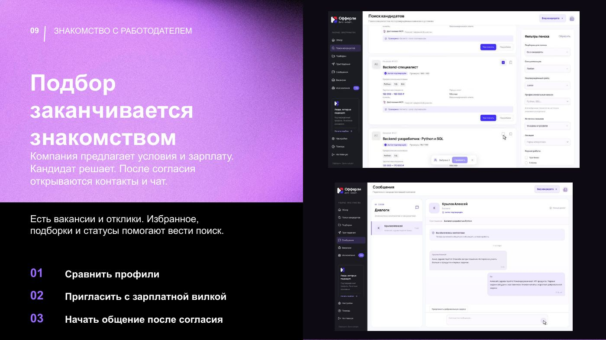
  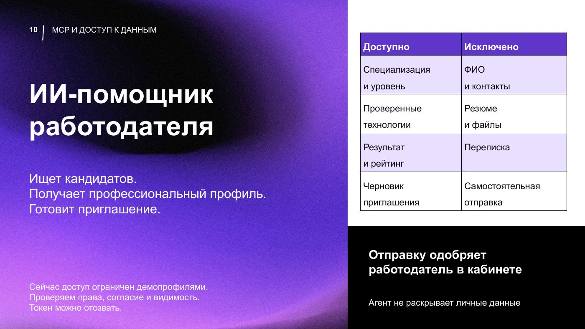
  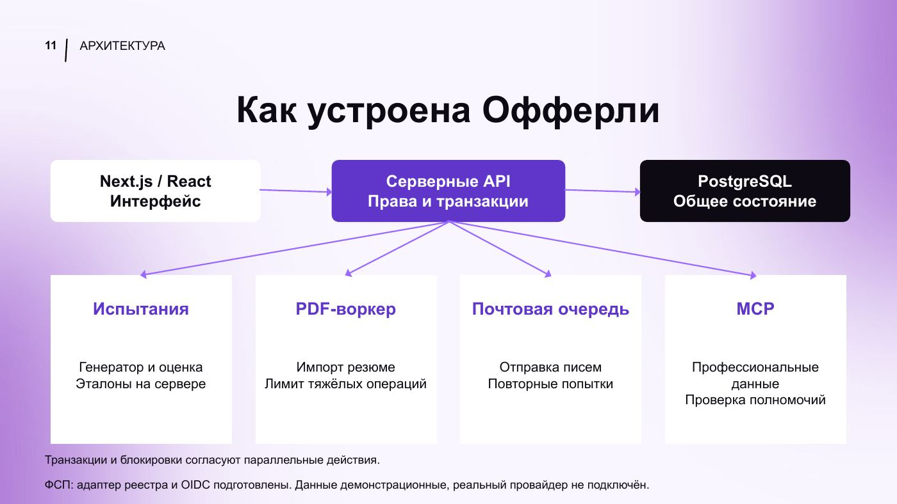
  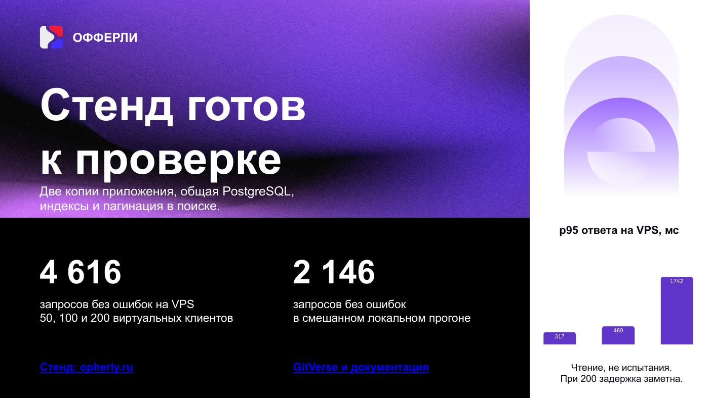
  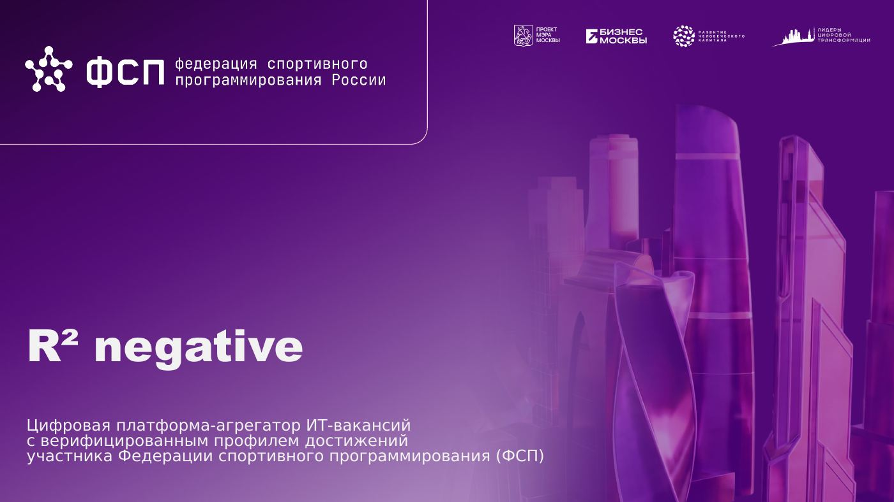
  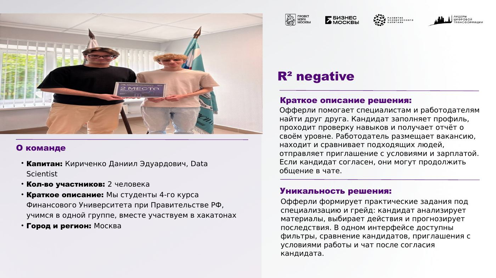
  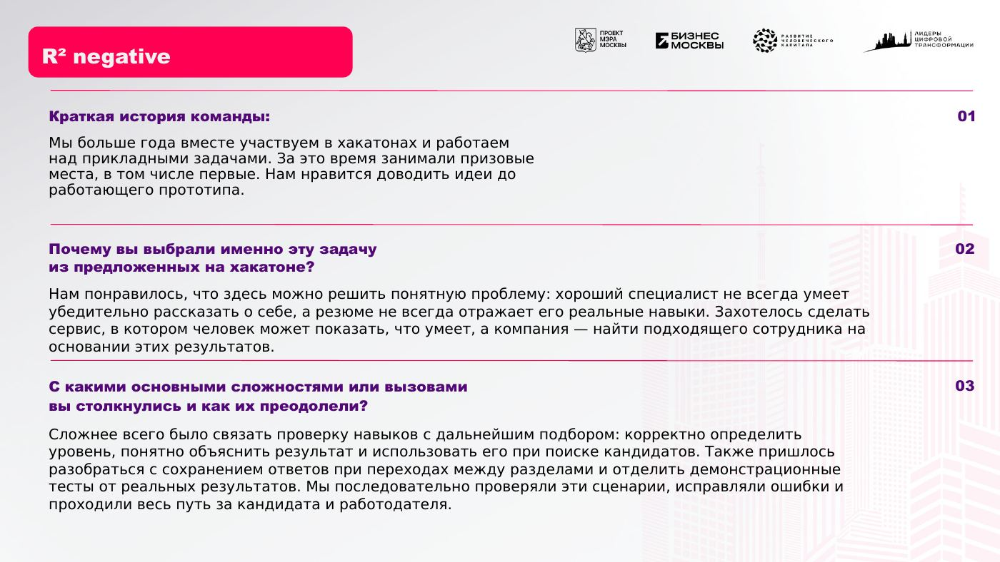
  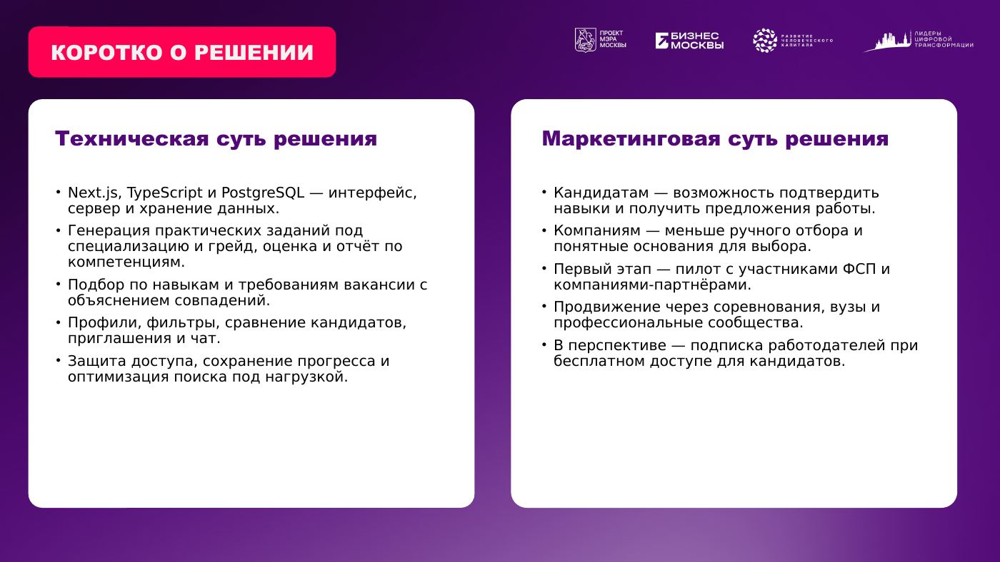
</p>

</details>

---
